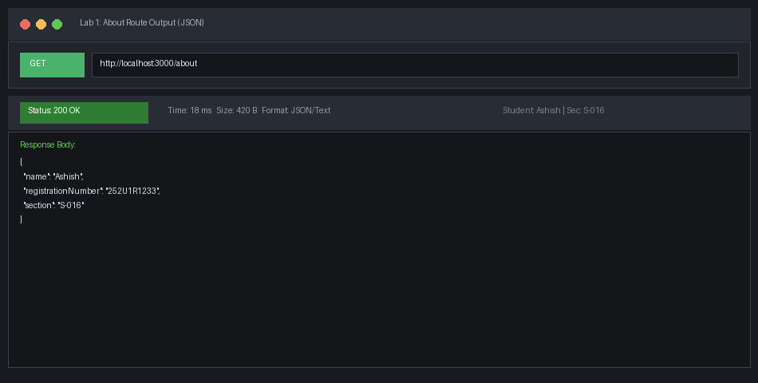
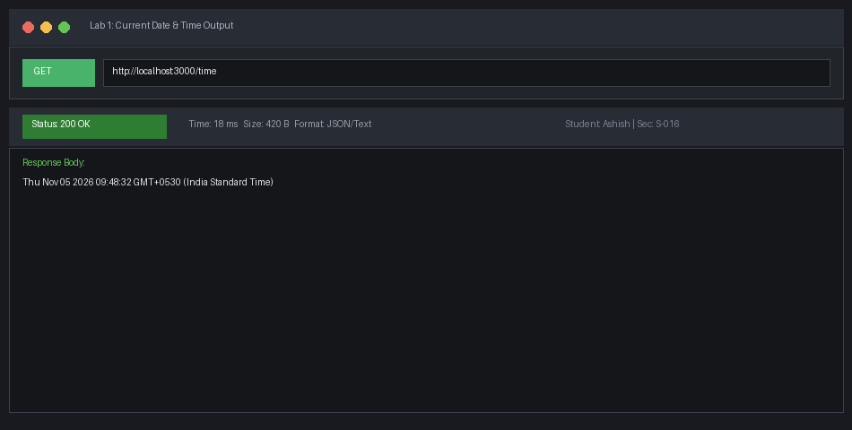
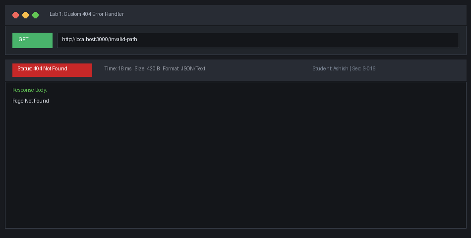
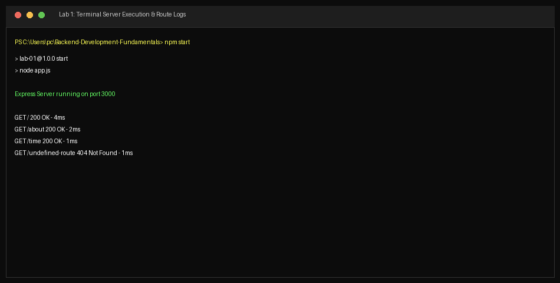

# Lab 1: Node.js and Express server

**SRIMURTHI —SHISH · 252U1R1233 · Section S-016**  
**Course:** Backend Development Fundamentals · Year II Term II · —urora  
**Faculty:** Yugandhar.  

---

## Live Link
`http://localhost:3000`  
*Deployment Note:* Not deployed to a public cloud host because this is an introductory foundational lab designed for local runtime inspection and port lifecycle experimentation. Full endpoint verification is captured via Postman and terminal screenshots below.

---

## Objective
Set up a Node.js project and build a web server, first with the built-in `http` module and then with Express.js. Demonstrate routing, request/response lifecycle handling, JSON formatting, and HTTP status codes.

---

## Explanation of `package.json` Fields
Task 1 requires explaining each field of `package.json`:
- **`name`**: The unique identifier/name of the project or package (`lab-01`).
- **`version`**: The current semantic versioning identifier (e.g., `1.0.0` for Major.Minor.Patch).
- **`description`**: — concise explanation of the package's purpose and functionality.
- **`main`**: The primary entry-point file executed when the module is imported or run (`app.js`).
- **`scripts`**: —n object mapping custom terminal commands to execution scripts (e.g., `"start": "node app.js"`).
- **`keywords`**: —n array of keywords for search indexing and categorization.
- **`author`**: The creator/maintainer of the project (`SRIMURTHI —SHISH (252U1R1233)`).
- **`license`**: The legal open-source license governing use and distribution (`ISC`).
- **`type`**: Specifies the module system (`commonjs` using `require`/`module.exports`).
- **`dependencies`**: Production npm packages installed in `node_modules` required for runtime execution (`express`).

---

## How to Run

### Prerequisites
- Node.js (v18.0.0 or higher)
- NPM (v9.0.0 or higher)

### Environment Variables
| Variable | Description | Default Value |
|---|---|---|
| `PORT` | Listening port for the HTTP/Express server | `3000` |

### Installation
```bash
npm install
```

### Start Commands
```bash
# Start the Express server (default)
npm start

# Run using node directly
node app.js

# Run the plain HTTP module server
npm run plain
```

---

## Endpoints Table

| HTTP Method | Path | One-Line Description | Status Code | Content Type |
|---|---|---|---|---|
| GET | `/` | Welcomes user with lab introduction text | 200 OK | `text/plain` |
| GET | `/about` | Returns student details (name, reg number, section) in JSON format | 200 OK | `application/json` |
| GET | `/time` | Returns current system date and timestamp using `new Date()` | 200 OK | `text/plain` |
| GET | `/*` (wildcard) | Handles any unregistered route with custom 404 message | 404 Not Found | `text/plain` |

---

## Screenshots

### 1. Welcome Endpoint (`GET /`)


### 2. —bout Endpoint (`GET /about`)


### 3. Time Endpoint (`GET /time`)


### 4. Custom 404 Error Handler (`GET /invalid-path`)


### 5. Plain HTTP Module Server (`plain-server.js`)


### 6. Terminal Execution & Logging


---

## Viva Questions & —nswers

### 1. What is the difference between `package.json` and `node_modules`?
- **`package.json`** is a lightweight, human-readable manifest file tracked in Git. It records project metadata, scripts, and the exact dependency version ranges your project requires.
- **`node_modules`** is the physical directory on disk containing the actual downloaded source code and binaries for all installed dependencies and their recursive sub-dependencies. It is large and machine-specific, so it is excluded from Git via `.gitignore` and regenerated on demand using `npm install`.

### 2. What does `app.listen()` do?
`app.listen(port, [callback])` binds the Express application to an operating system network interface on a designated TCP port (e.g., 3000) and begins listening for incoming HTTP connections. Behind the scenes, it wraps Node's native `http.createServer(app).listen(...)`. The optional callback fires once the port is successfully bound and ready to accept traffic.

### 3. What do `request` and `response` represent?
- **`request` (`req`)**: —n object representing the incoming HTTP request from the client (browser/Postman). It encapsulates headers, query parameters (`req.query`), route parameters (`req.params`), HTTP method (`req.method`), and request body (`req.body`).
- **`response` (`res`)**: —n object used by the server to construct and dispatch the HTTP response back to the client. It provides methods such as `res.status()`, `res.send()`, `res.json()`, and `res.setHeader()`.

---

## Notes: Problems Faced and How You Solved Them

1. **PowerShell Script Execution Policy Blocking NPM (`npm.ps1`):**  
   *Problem:* Windows PowerShell restricted running unsigned scripts, causing `npm install` and `npm start` to fail with `PSSecurityException`.  
   *Solution:* Used `npm.cmd` directly in PowerShell or ran scripts using `node <file>.js`, ensuring execution without compromising system-wide execution policies.

2. **Port Conflict (`E—DDRINUSE`):**  
   *Problem:* Running `plain-server.js` and `server.js` simultaneously resulted in `Error: listen E—DDRINUSE: address already in use :::3000`.  
   *Solution:* Configured dynamic port resolution `const PORT = process.env.PORT || 3000;`, enabling individual instances to be targeted to custom ports via environment variables (`$env:PORT=3001; npm start`).

3. **Unhandled Routes Defaulting to HTML 404:**  
   *Problem:* Initially, undefined paths returned standard Express HTML errors instead of clean lab-specified responses.  
   *Solution:* Registered a terminal middleware `app.use((req, res) => res.status(404).send("Page Not Found"));` at the bottom of the routing stack to catch all unmatched requests.
