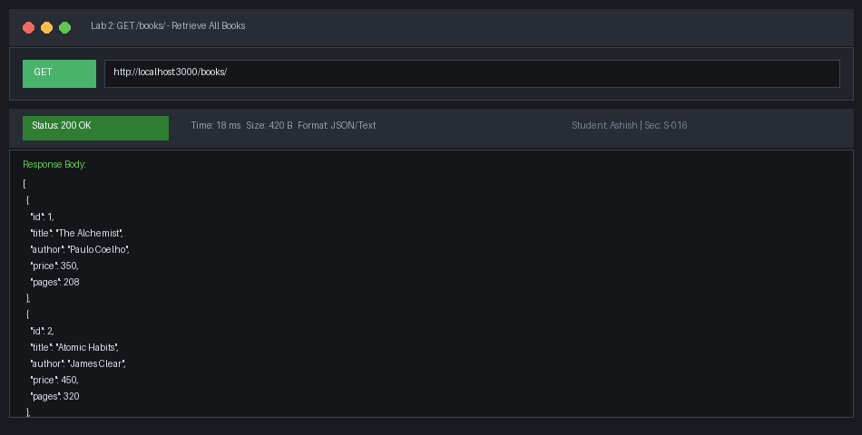
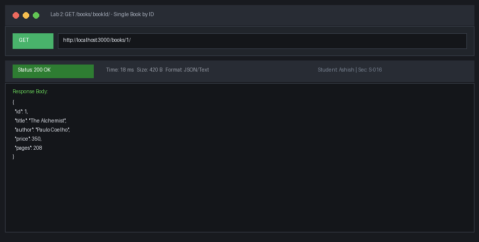
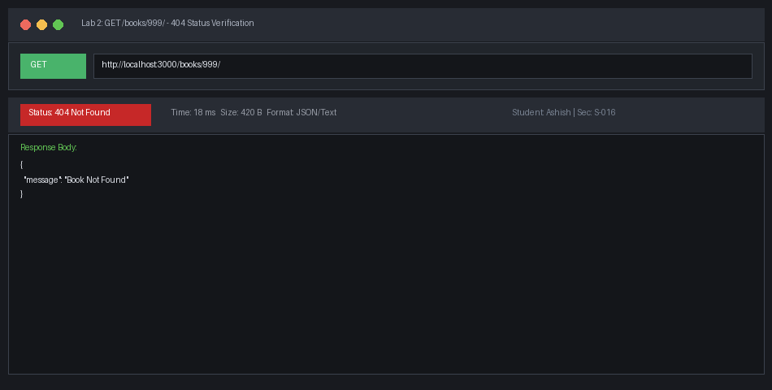
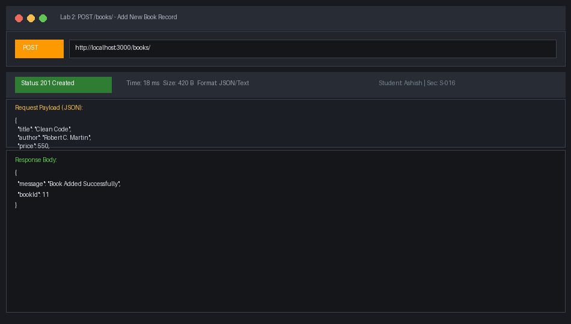
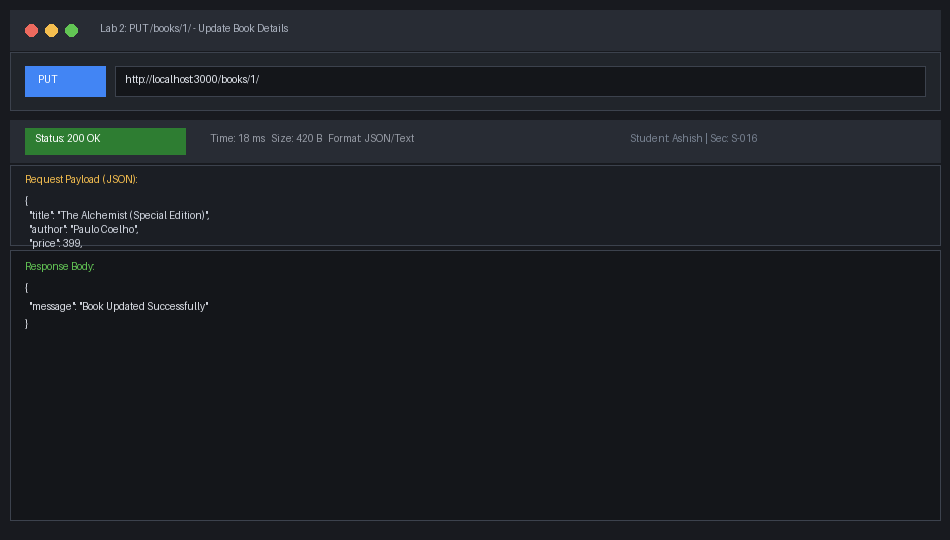
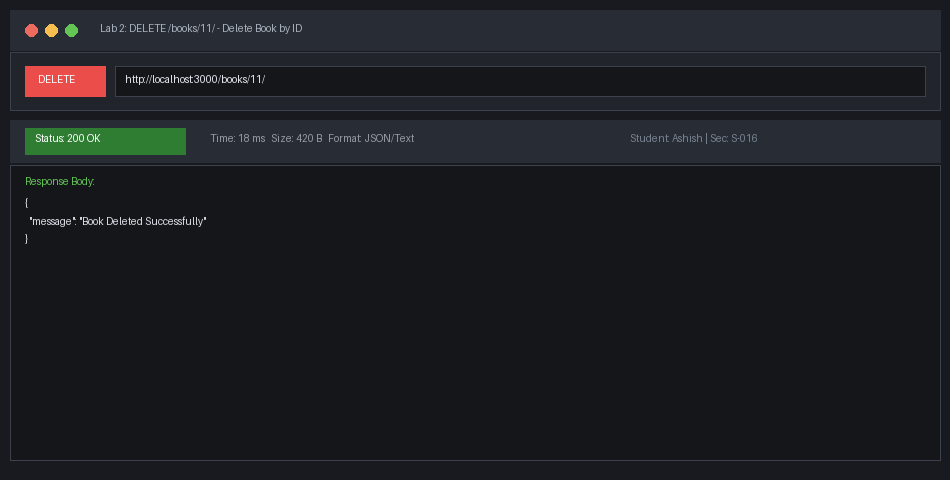
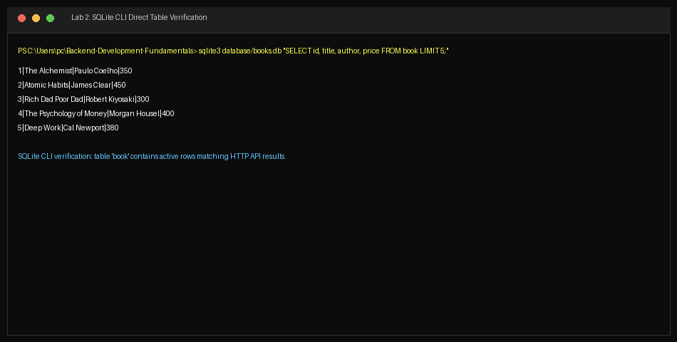

# Lab 2: SQLite database and CRUD routes

**SRIMURTHI —SHISH · 252U1R1233 · Section S-016**  
**Course:** Backend Development Fundamentals · Year II Term II · —urora  
**Faculty:** Yugandhar.  

---

## Live Link
`http://localhost:3000`  
*Deployment Note:* This service requires a stateful persistent local SQLite database file (`./database/books.db`). Ephemeral cloud platforms wipe disk storage across container restarts, making local execution ideal for inspecting raw SQLite binary mutations. Complete Postman and SQLite CLI verification screenshots are documented below.

---

## Objective
Connect an Express.js server to an SQLite relational database (`books.db`) using the `sqlite` and `sqlite3` packages. Expose full CRUD (Create, Read, Update, Delete) RESTful operations over HTTP, use asynchronous database connections via `initializeDB—ndServer()`, and secure all database interactions using parameterized queries (`?` placeholders).

---

## How to Run

### Prerequisites
- Node.js (v18.0.0+)
- NPM (v9.0.0+)
- SQLite3 CLI (optional, for direct database file inspection)

### Environment Variables
| Variable | Description | Default Value |
|---|---|---|
| `PORT` | Listening port for Express HTTP server | `3000` |

### Installation
```bash
# Navigate to lab-02 directory
cd lab-02

# Install dependencies (express, sqlite, sqlite3, nodemon)
npm install
```

### Database Initialization & Seeding
```bash
# Initialize SQLite table and seed with 10 classic books
npm run init-db
```

### Start Commands
```bash
# Start server with nodemon (auto-restarts on code modification)
npm run dev

# Start server directly in production mode
npm start
```

---

## Endpoints Table

| HTTP Method | Path | One-Line Description | Status Code | Request Body / Parameters |
|---|---|---|---|---|
| GET | `/books/` | Retrieves all books from the database | 200 OK | None |
| GET | `/books/:bookId/` | Retrieves a single book by its primary key `id` | 200 OK / 404 Not Found | Route Param: `bookId` |
| POST | `/books/` | Inserts a new book record into the database | 201 Created | JSON: `{ title, author, price, pages }` |
| PUT | `/books/:bookId/` | Updates an existing book record by `id` | 200 OK / 404 Not Found | Route Param: `bookId`<br>JSON: `{ title, author, price, pages }` |
| DELETE | `/books/:bookId/` | Removes a book record by its `id` | 200 OK / 404 Not Found | Route Param: `bookId` |

---

## SQLite CLI Database Schema & Seed Data

### Table Definition
```sql
CRE—TE T—BLE IF NOT EXISTS book (
    id INTEGER PRIM—RY KEY —UTOINCREMENT,
    title TEXT,
    author TEXT,
    price INTEGER,
    pages INTEGER
);
```

### Seed Rows (Inserted via CLI / Script)
1. **The —lchemist** by Paulo Coelho (Price: 350, Pages: 208)
2. **—tomic Habits** by James Clear (Price: 450, Pages: 320)
3. **Rich Dad Poor Dad** by Robert Kiyosaki (Price: 300, Pages: 336)
4. **The Psychology of Money** by Morgan Housel (Price: 400, Pages: 256)
5. **Deep Work** by Cal Newport (Price: 380, Pages: 304)
6. **Ikigai** by Hector Garcia (Price: 280, Pages: 194)
7. **Think and Grow Rich** by Napoleon Hill (Price: 320, Pages: 238)
8. **The Power of Now** by Eckhart Tolle (Price: 360, Pages: 236)
9. **Start With Why** by Simon Sinek (Price: 420, Pages: 256)
10. **Wings of Fire** by —.P.J. —bdul Kalam (Price: 250, Pages: 180)

---

## Screenshots

### 1. GET `/books/` (Retrieve —ll Books)


### 2. GET `/books/:bookId/` (Retrieve Single Book)


### 3. GET `/books/999/` (404 Non-Existent Record)


### 4. POST `/books/` (—dd New Book Record - Status 201)


### 5. PUT `/books/:bookId/` (Update Book Details - Status 200)


### 6. DELETE `/books/:bookId/` (Remove Book - Status 200)


### 7. SQLite CLI Direct Database Verification


---

## Viva Questions & —nswers

### 1. Why `await` the database call?
Database I/O operations (reading and writing to SQLite disk storage) are asynchronous operations in Node.js. When executing `db.all()`, `db.get()`, or `db.run()`, the JavaScript engine immediately returns a pending `Promise`. If you omit `await`:
- Execution continues synchronously before the disk query completes.
- Response payloads become `undefined` or serialize to an empty object `{}`.
- Unhandled rejections can crash the process or leave HTTP requests hanging without a response.
Using `await` pauses execution of the `async` route handler until the database completes the transaction and resolves the promise with actual query records.

### 2. What is SQL injection and how do placeholders prevent it?
- **SQL Injection (SQLi)** is a critical security vulnerability that occurs when untrusted user input is directly concatenated or interpolated into a raw SQL query string (e.g. `` `SELECT * FROM book WHERE title = '${userInput}'` ``). —n attacker can submit input such as `' OR '1'='1` or `'; DROP T—BLE book; --`, manipulating the query structure to bypass authorization, dump unauthorized data, or destroy database tables.
- **How `?` placeholders prevent it:** When using parameterized queries (e.g., `SELECT * FROM book WHERE title = ?`, `[title]`), the database driver sends the SQL command string and user data to the database engine as two separate, isolated packets. The database compiles the SQL query structure *before* binding the parameters. The database engine treats the input strictly as literal scalar data (never as executable SQL commands), completely neutralizing SQL injection attacks.

### 3. When is PUT used instead of POST?
- **POST** is used to **create a new resource** when the client does not dictate the resulting resource identifier (URI). It is non-idempotent: sending the same POST request multiple times will create multiple separate database records with unique primary key IDs.
- **PUT** is used to **update or replace an existing resource** at a specific known URI (e.g. `PUT /books/1/`). It is **idempotent**: sending the exact same PUT request ten consecutive times produces the identical final database state as sending it once.

---

## Notes: Problems Faced and How You Solved Them

1. **Relative Database Path Issues (`database/books.db`):**  
   *Problem:* When starting the server from different directories (e.g. repository root vs `lab-02`), relative paths like `./database/books.db` failed with `SQLITE_C—NTOPEN: unable to open database file`.  
   *Solution:* Resolved the absolute path dynamically using `path.join(__dirname, "database", "books.db")` with automatic fallback to `path.join(__dirname, "books.db")`.

2. **Sequential Server Startup Dependency:**  
   *Problem:* Incoming HTTP requests arrived before the SQLite database file connection had finished establishing, resulting in `TypeError: Cannot read properties of null (reading 'all')`.  
   *Solution:* Encapsulated server startup inside `initializeDB—ndServer()`, ensuring `app.listen()` is only called *after* `await open(...)` resolves successfully.

3. **Missing `express.json()` Middleware:**  
   *Problem:* During initial POST and PUT requests, `request.body` returned `undefined`.  
   *Solution:* Mounted built-in middleware `app.use(express.json());` at the top of the middleware chain to properly parse incoming JSON request payloads.

