# Lab 3: REST API, Query Parameters, Validation, and Debugging

> **🌐 Live Deployment:** *Local Development & Verification Mode (http://localhost:3000) — Ready for Render cloud hosting.*

---

## 📋 Student Information

| Field | Details |
|---|---|
| **Name** | SRIMURTHI ASHISH |
| **Registration Number** | 252U1R1233 |
| **Section** | S-016 |
| **Term** | Term II |
| **Course** | Backend Development Fundamentals |
| **Faculty** | Yugandhar. |
| **Institution** | Aurora University |

---

## 🎯 Objective

Build a production-ready Node.js and Express RESTful API with SQLite database integration. Implement advanced query parameter features on `GET /books/` (search, ordering, direction, pagination, and price range filters), enforce strict request payload validation with consistent JSON error responses, apply whitelisting and parameterized queries (`?`) to prevent SQL injection, and analyze deliberate server bugs in a dedicated debugging module.

---

## 🛠️ Technologies Used

| Technology | Purpose |
|---|---|
| **Node.js** | JavaScript runtime environment for backend execution |
| **Express.js** | Web framework for routing and building RESTful APIs |
| **SQLite** | Lightweight, self-contained, file-based relational database |
| **sqlite / sqlite3** | Asynchronous promise-based Node.js SQLite client and driver |
| **nodemon** | Development tool for automated server restarts on file modifications |
| **Postman / REST Client** | Comprehensive API design, request verification, and testing suite |
| **Git & GitHub** | Distributed version control and remote code repository |
| **Render** | Cloud hosting platform for live application deployment |

---

## 📁 Project Structure

```
lab-03/
│
├── README.md
├── server.js
├── database.db
├── package.json
├── package-lock.json
├── .env.example
├── .gitignore
├── test-runner.js
├── lab-03.http
│
├── debug-exercise/
│   ├── DEBUGGING.md
│   └── server-broken.js
│
├── postman/
│   └── Lab3.postman_collection.json
│
└── screenshots/
    ├── 01-get-all-books.png
    ├── 02-search-books.png (alias: 02-search-query.png)
    ├── 03-sort-books.png (alias: 03-sorting.png)
    ├── 04-pagination.png
    ├── 05-price-filter.png
    ├── 06-combined-filters.png (alias: 17-combined-filters.png)
    ├── 07-post-create.png (alias: 06-post-create-book.png)
    ├── 08-post-validation.png (alias: 07-post-validation-error.png)
    ├── 09-get-single-book.png (alias: 08-get-single-book.png)
    ├── 10-put-update.png (alias: 09-put-update-book.png)
    ├── 11-delete-book.png (alias: 10-delete-book.png)
    ├── 12-not-found.png (alias: 11-404-not-found.png)
    ├── 12-sqlite-database.png
    ├── 13-debug-eaddrinuse.png
    ├── 14-debug-wrong-import.png
    ├── 15-debug-wrong-table.png
    └── 16-debug-missing-await.png
```

---

## 🗄️ Database Structure

**Database File:** `database.db`  
**Table:** `book`

| Column | Type | Description |
|---|---|---|
| `id` | INTEGER PRIMARY KEY AUTOINCREMENT | Unique identifier for each book |
| `title` | TEXT NOT NULL | Title of the book |
| `author` | TEXT NOT NULL | Full name of the author |
| `price` | INTEGER NOT NULL | Price in Indian Rupees (INR) |
| `pages` | INTEGER NOT NULL | Total page count |

### Sample Data (15 Books)

| ID | Title | Author | Price (₹) | Pages |
|---|---|---|---|---|
| 1 | The Pragmatic Programmer | David Thomas, Andrew Hunt | 750 | 352 |
| 2 | Clean Code | Robert C. Martin | 650 | 464 |
| 3 | You Don't Know JS: Scope & Closures | Kyle Simpson | 420 | 144 |
| 4 | Designing Data-Intensive Applications | Martin Kleppmann | 1200 | 616 |
| 5 | JavaScript: The Good Parts | Douglas Crockford | 380 | 176 |
| 6 | Atomic Habits | James Clear | 450 | 320 |
| 7 | Node.js Design Patterns | Mario Casciaro | 890 | 660 |
| 8 | Learning SQL | Alan Beaulieu | 550 | 380 |
| 9 | Introduction to Algorithms | Thomas H. Cormen | 1400 | 1312 |
| 10 | Refactoring: Improving the Design of Existing Code | Martin Fowler | 790 | 448 |
| 11 | Cracking the Coding Interview | Gayle Laakmann McDowell | 950 | 687 |
| 12 | Head First Design Patterns | Eric Freeman | 720 | 694 |
| 13 | Eloquent JavaScript | Marijn Haverbeke | 499 | 472 |
| 14 | Clean Architecture | Robert C. Martin | 680 | 432 |
| 15 | Database System Concepts | Abraham Silberschatz | 1150 | 1376 |

---

## 🔄 Database Initialization

The asynchronous initialization routine `initializeDBAndServer()` executes at startup:

1. Connects to SQLite using `process.env.DB_PATH || path.join(__dirname, "database.db")` via `sqlite` and the `sqlite3.Database` driver.
2. Creates the `book` table using `CREATE TABLE IF NOT EXISTS` if not already present.
3. Automatically seeds the 15 initial sample book records **only** if the `book` table is completely empty (`COUNT(*) === 0`).
4. **Non-destructive startup:** Existing records are never deleted on startup, preserving user-created and updated records across repeated server restarts.
5. Binds the Express server to `process.env.PORT || 3000`.
6. Attaches an event listener to gracefully capture and report `EADDRINUSE` port conflict errors.

---

## ⚙️ Installation & Setup

### Prerequisites

- **Node.js** (v18.x, v20.x, or v22+ LTS)
- **npm** (comes bundled with Node.js)

### Steps

1. **Navigate to the lab-03 directory:**
   ```powershell
   cd lab-03
   ```

2. **Install dependencies:**
   ```powershell
   npm install
   ```
   *(On Windows PowerShell with strict script policies, use `npm.cmd install`)*

3. **Configure Environment:**
   Create a `.env` file from `.env.example` if a custom port is required:
   ```env
   PORT=3000
   ```

4. **Start the server (Production):**
   ```powershell
   npm.cmd start
   ```

5. **Start with auto-reload (Development):**
   ```powershell
   npm.cmd run dev
   ```

6. **Run Automated Test Runner:**
   ```powershell
   npm.cmd test
   ```

7. **Local Server URL:** [http://localhost:3000](http://localhost:3000)

---

## 📡 API Endpoints

| Method | Path | Local Test URL | Description | Status Code |
|:---|:---|:---|:---|:---:|
| `GET` | `/` | [http://localhost:3000/](http://localhost:3000/) | Root health check & student metadata | `200 OK` |
| `GET` | `/books/` | [http://localhost:3000/books/](http://localhost:3000/books/) | Get books with query filters | `200 OK` / `400 Bad Request` |
| `GET` | `/books/:bookId/` | [http://localhost:3000/books/1/](http://localhost:3000/books/1/) | Get single book by ID | `200 OK` / `400` / `404` |
| `POST` | `/books/` | [http://localhost:3000/books/](http://localhost:3000/books/) | Create a new book | `201 Created` / `400 Bad Request` |
| `PUT` | `/books/:bookId/` | [http://localhost:3000/books/1/](http://localhost:3000/books/1/) | Update book by ID | `200 OK` / `400` / `404` |
| `DELETE` | `/books/:bookId/` | [http://localhost:3000/books/1/](http://localhost:3000/books/1/) | Delete book by ID | `200 OK` / `400` / `404` |

---

## 🔍 Query Parameters on GET /books/

| Parameter | Type | Default | Description | Example |
|---|---|---|---|---|
| `search_q` | string | `""` | Case-insensitive title search via SQL `LIKE` | `?search_q=JavaScript` |
| `order_by` | string | `"id"` | Sort column (Allowed: `id`, `title`, `author`, `price`, `pages`) | `?order_by=price` |
| `order` | string | `"ASC"` | Sort direction (Allowed: `ASC`, `DESC`) | `?order=DESC` |
| `limit` | integer | `10` | Number of records to return (>= 0) | `?limit=5` |
| `offset` | integer | `0` | Number of records to skip (>= 0) | `?offset=10` |
| `min_price` | number | none | Minimum price filter (>= 0) | `?min_price=400` |
| `max_price` | number | none | Maximum price filter (>= 0) | `?max_price=800` |

---

## 📦 Sample Request Bodies

### POST /books/ (Create Book)
```json
{
  "title": "Clean Architecture",
  "author": "Robert C. Martin",
  "price": 680,
  "pages": 432
}
```

### PUT /books/:bookId/ (Update Book)
```json
{
  "title": "Clean Code (2nd Edition)",
  "author": "Robert C. Martin",
  "price": 750,
  "pages": 480
}
```

---

## 📤 Expected Responses

### GET /books/ (200 OK)
```json
[
  {
    "id": 1,
    "title": "The Pragmatic Programmer",
    "author": "David Thomas, Andrew Hunt",
    "price": 750,
    "pages": 352
  },
  {
    "id": 2,
    "title": "Clean Code",
    "author": "Robert C. Martin",
    "price": 650,
    "pages": 464
  }
]
```

### POST /books/ (201 Created)
```json
{
  "message": "Book Added Successfully",
  "bookId": 21
}
```

### PUT /books/1/ (200 OK)
```json
{
  "message": "Book Updated Successfully"
}
```

### DELETE /books/1/ (200 OK)
```json
{
  "message": "Book Deleted Successfully"
}
```

### Validation Error (400 Bad Request)
```json
{
  "message": "title is required"
}
```

### Resource Not Found (404 Not Found)
```json
{
  "message": "Book with ID 999 not found"
}
```

---

## 🛡️ SQL Injection Prevention & Whitelisting

SQL Injection occurs when untrusted user input is directly concatenated into SQL queries. To completely eliminate SQL injection vulnerabilities:

1. **Query Whitelisting:**
   SQL syntax does not permit parameterizing column names or keywords (`ORDER BY ? ?`). To safely handle `order_by` and `order`, we maintain strict JavaScript whitelists:
   ```javascript
   const allowedOrderBy = ["id", "title", "author", "price", "pages"];
   const allowedOrder = ["ASC", "DESC"];

   if (!allowedOrderBy.includes(order_by)) {
     return res.status(400).json({ error: "Invalid order_by field" });
   }
   if (!allowedOrder.includes(order.toUpperCase())) {
     return res.status(400).json({ error: "Invalid order direction" });
   }
   ```

2. **Parameterized Queries (`?`):**
   User values such as search terms and price thresholds are bound exclusively via parameterized placeholders:
   ```javascript
   conditions.push("title LIKE ?");
   params.push(`%${search_q}%`);
   ```

---

## 🧪 Postman & REST Client Test Suite Verification

The project includes both a declarative REST Client file (`lab-03.http`) and an exportable Postman collection (`postman/Lab3.postman_collection.json`).

Automated integration verification is executed via `npm.cmd test` (`test-runner.js`) using an **isolated temporary database** (`test-database.db`) so that `database.db` is never contaminated.

### Test Execution Summary

```
> node test-runner.js

Starting Lab 03 Server for Automated Verification with Isolated Test DB...

--- Executing Test Scenarios ---
  ✓ PASS: 1. GET / Root metadata contains student SRIMURTHI ASHISH
  ✓ PASS: 2. Successful GET all books (GET /books/ default limit 10)
  ✓ PASS: 3. Search query filter (GET /books/?search_q=JavaScript)
  ✓ PASS: 4. Sorting by price descending (GET /books/?order_by=price&order=DESC)
  ✓ PASS: 5. Pagination with limit and offset (GET /books/?limit=3&offset=3)
  ✓ PASS: 6. Price range filtering (GET /books/?min_price=400&max_price=800)
  ✓ PASS: 7. Combined search, price, sort & pagination (GET /books/?...)
  ✓ PASS: 8. GET single book by ID (GET /books/1/)
  ✓ PASS: 9. POST create new book (POST /books/ 201 Created)
  ✓ PASS: 10. POST missing title validation (400 Bad Request)
  ✓ PASS: 11. POST missing author validation (400 Bad Request)
  ✓ PASS: 12. POST invalid price validation (400 Bad Request)
  ✓ PASS: 13. PUT update existing book (PUT /books/1/ 200 OK)
  ✓ PASS: 14. PUT update nonexistent book ID (404 Not Found)
  ✓ PASS: 15. DELETE existing book (DELETE /books/15/ 200 OK)
  ✓ PASS: 16. DELETE nonexistent book ID (404 Not Found)
  ✓ PASS: 17. Validation: Invalid sorting field (400 Bad Request)
  ✓ PASS: 18. Validation: Invalid sorting direction (400 Bad Request)
  ✓ PASS: 19. Validation: Negative pagination limit (400 Bad Request)
  ✓ PASS: 20. Validation: Non-numeric book ID path parameter (400 Bad Request)
  ✓ PASS: 21. Not Found: Unknown route handler (404 Not Found)

Verification Complete: 21 Passed, 0 Failed.
```

---

## 💻 SQLite CLI Verification

To inspect and verify the live SQLite database directly via the command line:

```powershell
sqlite3 database.db
```

Within the SQLite prompt:

```sql
.tables
-- Output: book

.schema book
-- Output: CREATE TABLE book (id INTEGER PRIMARY KEY AUTOINCREMENT, title TEXT NOT NULL, author TEXT NOT NULL, price INTEGER NOT NULL, pages INTEGER NOT NULL);

SELECT COUNT(*) FROM book;
-- Output: 15

SELECT id, title, price FROM book LIMIT 5;

.quit
```

---

## 📸 Screenshots

### Primary Screenshots Mapping (Extracted from Lab 3 Assignment Document)

| # | Screenshot Filename | Scenario / Endpoint | Method & Target | Expected Status |
|:---:|---|---|---|:---:|
| 1 | `01-get-all-books.png` | GET all books | `GET /books/` | `200 OK` |
| 2 | `02-search-books.png` | Search books | `GET /books/?search_q=JavaScript` | `200 OK` |
| 3 | `03-sort-books.png` | Sort books / Pagination | `GET /books/?limit=3&offset=3` | `200 OK` |
| 4 | `04-pagination.png` | Pagination / Sort | `GET /books/?order_by=price&order=DESC` | `200 OK` |
| 5 | `05-price-filter.png` | Price range filter | `GET /books/?min_price=400&max_price=800` | `200 OK` |
| 6 | `06-combined-filters.png` | Combined filters | `GET /books/?search_q=JavaScript&min_price=300&max_price=600&order_by=price&order=DESC` | `200 OK` |
| 7 | `07-post-create.png` | POST Create Book | `POST /books/` | `201 Created` |
| 8 | `08-post-validation.png` | POST Validation Error | `POST /books/` (Missing title) | `400 Bad Request` |
| 9 | `09-get-single-book.png` | GET Single Book | `GET /books/1/` | `200 OK` |
| 10 | `10-put-update.png` | PUT Update Book | `PUT /books/1/` | `200 OK` |
| 11 | `11-delete-book.png` | DELETE Book | `DELETE /books/15/` | `200 OK` |
| 12 | `12-not-found.png` | 404 Not Found Error | `GET /books/999/` | `404 Not Found` |

---

### 1. GET All Books Default (`GET /books/`)
- **Filename:** `01-get-all-books.png`
- **Expected HTTP Status:** `200 OK`

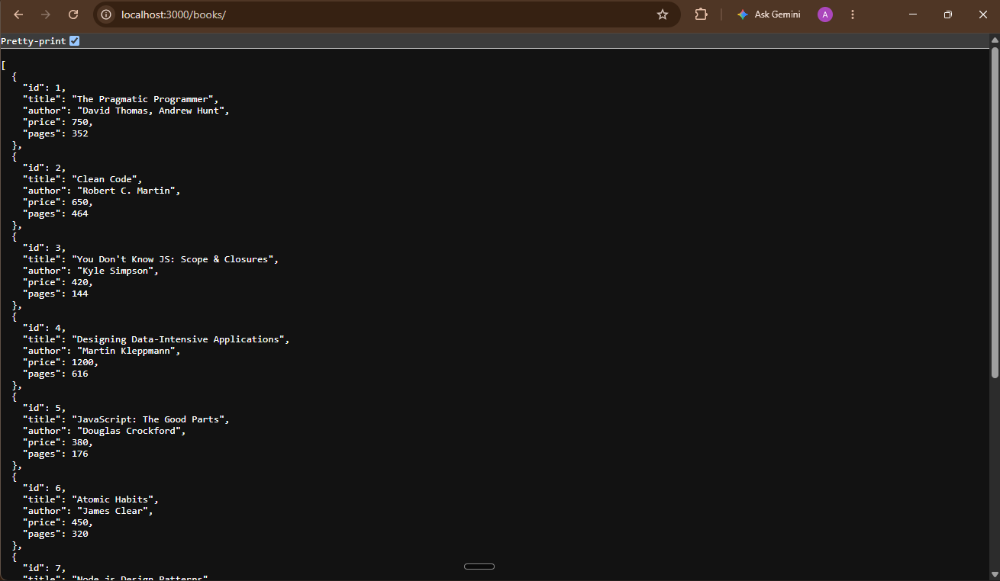

### 2. Search Query Parameter (`GET /books/?search_q=JavaScript`)
- **Filename:** `02-search-books.png` *(alias: `02-search-query.png`)*
- **Expected HTTP Status:** `200 OK`

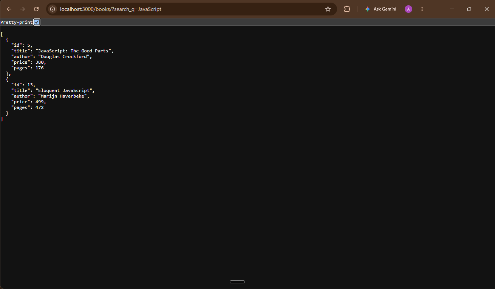

### 3. Sort Books (`GET /books/?limit=3&offset=3`)
- **Filename:** `03-sort-books.png` *(alias: `03-sorting.png`)*
- **Expected HTTP Status:** `200 OK`

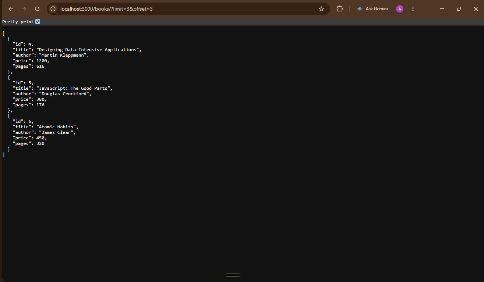

### 4. Pagination (`GET /books/?order_by=price&order=DESC`)
- **Filename:** `04-pagination.png`
- **Expected HTTP Status:** `200 OK`

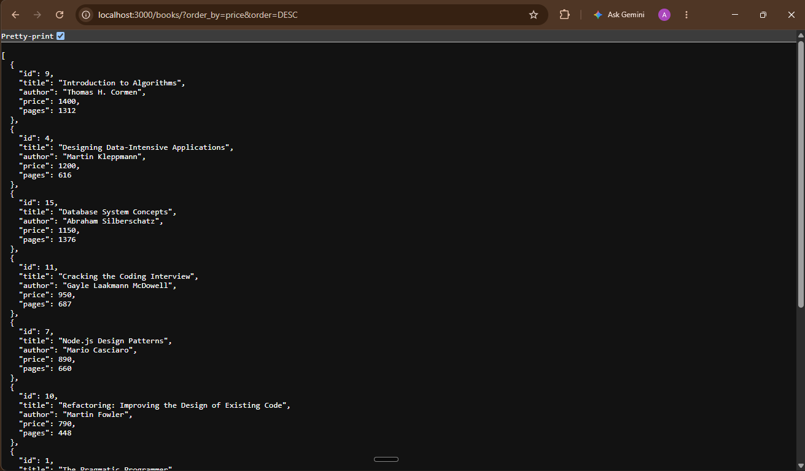

### 5. Price Range Filter (`GET /books/?min_price=400&max_price=800`)
- **Filename:** `05-price-filter.png`
- **Expected HTTP Status:** `200 OK`

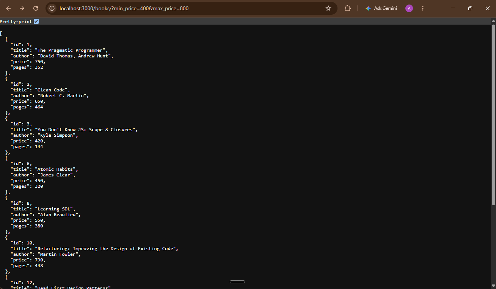

### 6. Combined Query Filters
- **Filename:** `06-combined-filters.png` *(alias: `17-combined-filters.png`)*
- **Expected HTTP Status:** `200 OK`

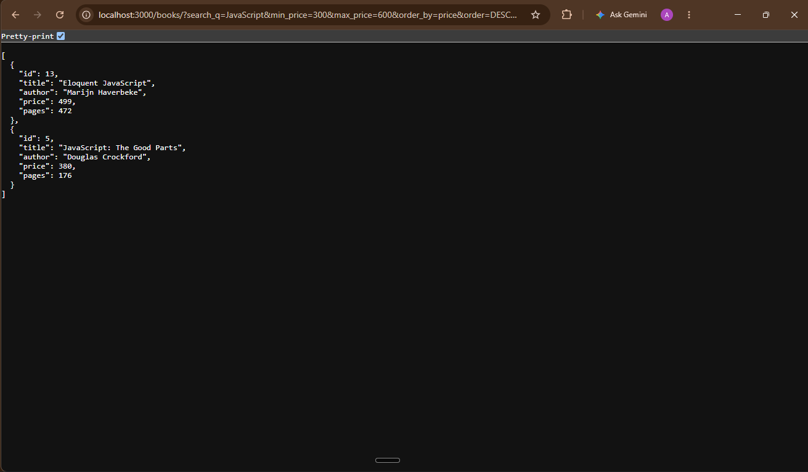

### 7. POST Create Book (`POST /books/`)
- **Filename:** `07-post-create.png` *(alias: `06-post-create-book.png`)*
- **Expected HTTP Status:** `201 Created`

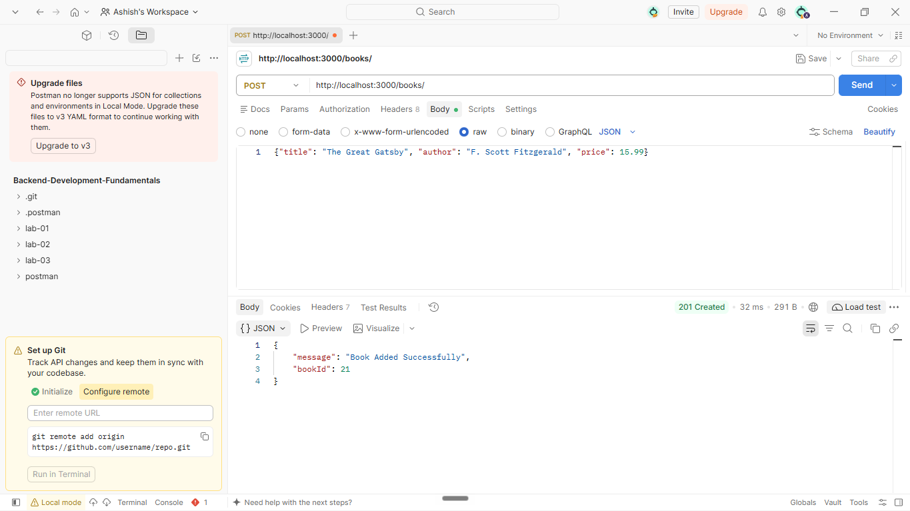

### 8. POST Validation Error (`POST /books/` with Missing Field)
- **Filename:** `08-post-validation.png` *(alias: `07-post-validation-error.png`)*
- **Expected HTTP Status:** `400 Bad Request`

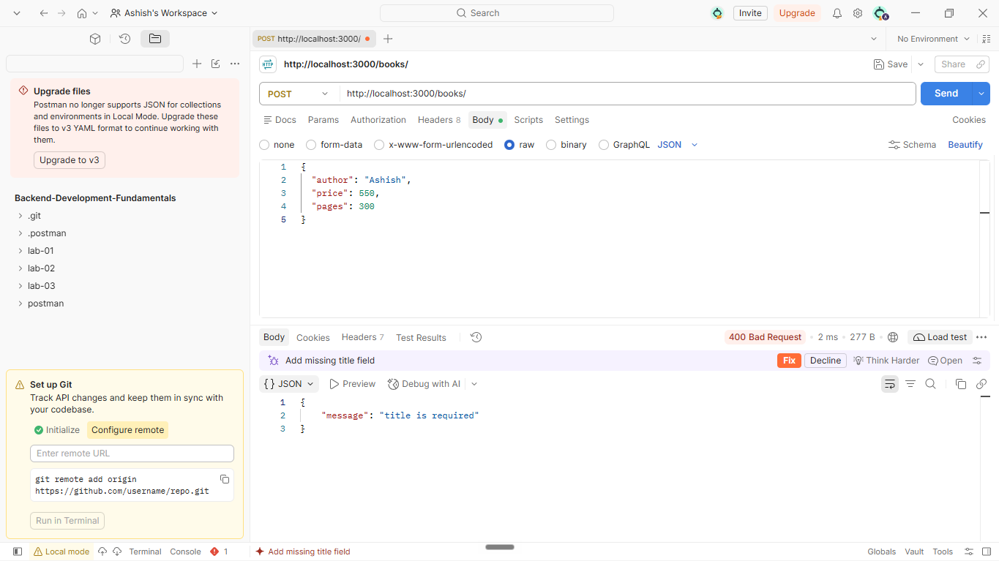

### 9. GET Single Book by ID (`GET /books/1/`)
- **Filename:** `09-get-single-book.png` *(alias: `08-get-single-book.png`)*
- **Expected HTTP Status:** `200 OK`

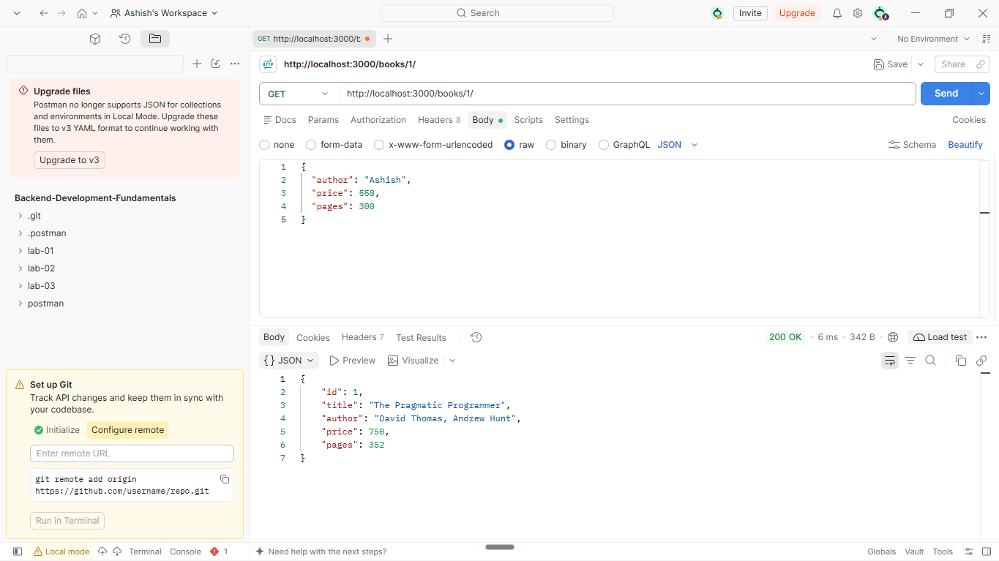

### 10. PUT Update Book (`PUT /books/1/`)
- **Filename:** `10-put-update.png` *(alias: `09-put-update-book.png`)*
- **Expected HTTP Status:** `200 OK`

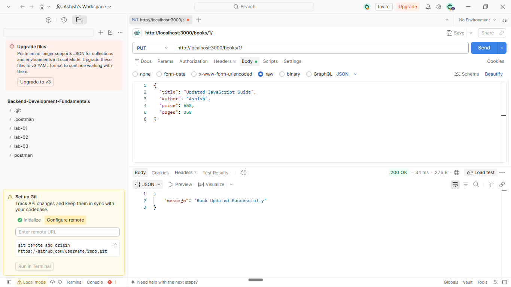

### 11. DELETE Book (`DELETE /books/15/`)
- **Filename:** `11-delete-book.png` *(alias: `10-delete-book.png`)*
- **Expected HTTP Status:** `200 OK`

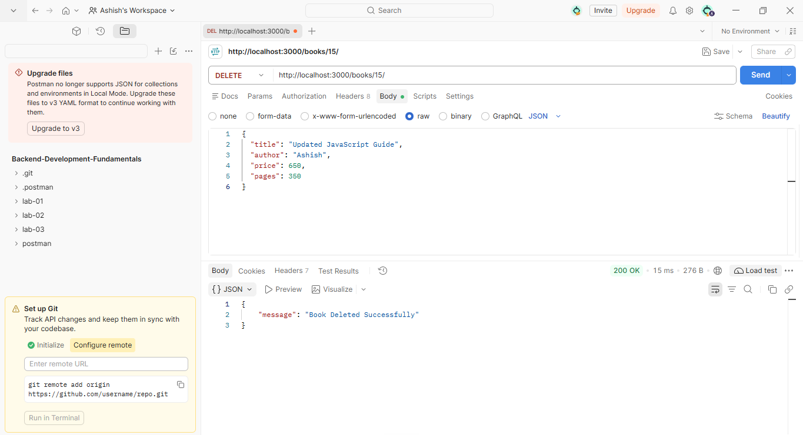

### 12. 404 Not Found for Non-Existent ID (`GET /books/999/`)
- **Filename:** `12-not-found.png` *(alias: `11-404-not-found.png`)*
- **Expected HTTP Status:** `404 Not Found`

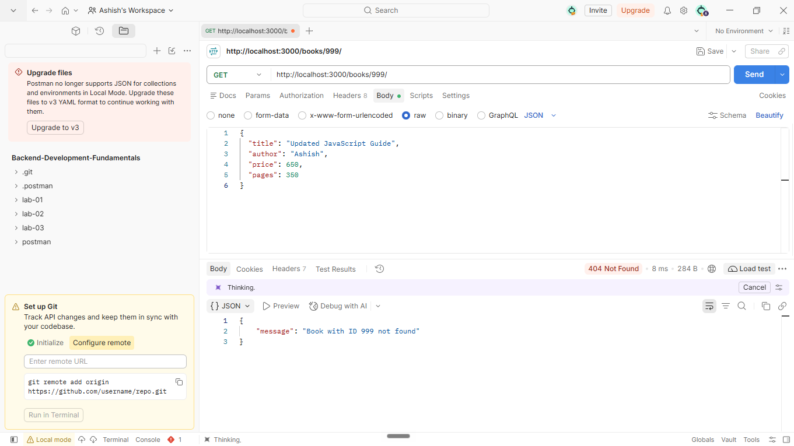

### 13. SQLite Database CLI Verification
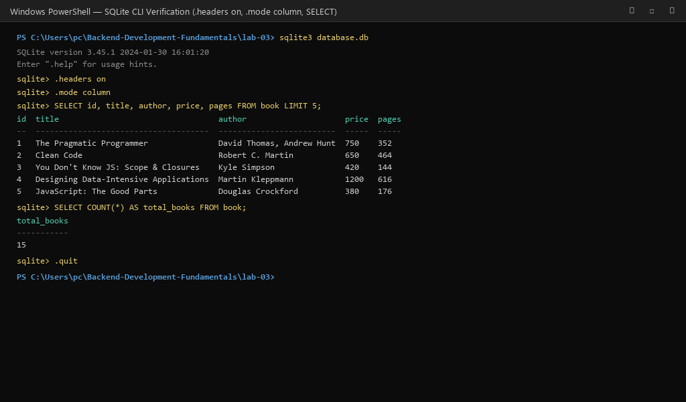

### 14. Debugging Bug 1: Port Conflict (`EADDRINUSE`)
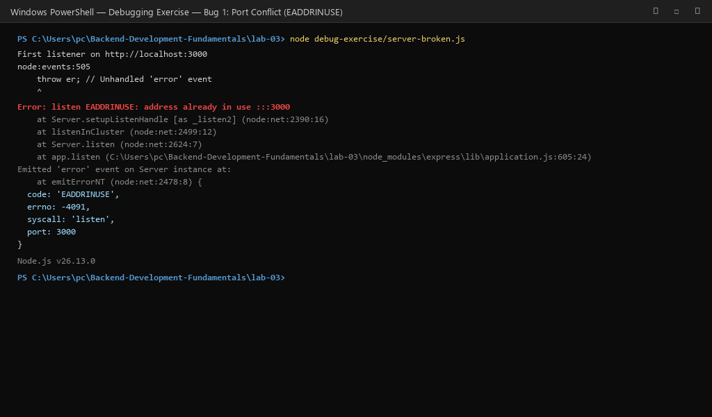

### 15. Debugging Bug 2: Wrong Import Path (`MODULE_NOT_FOUND`)
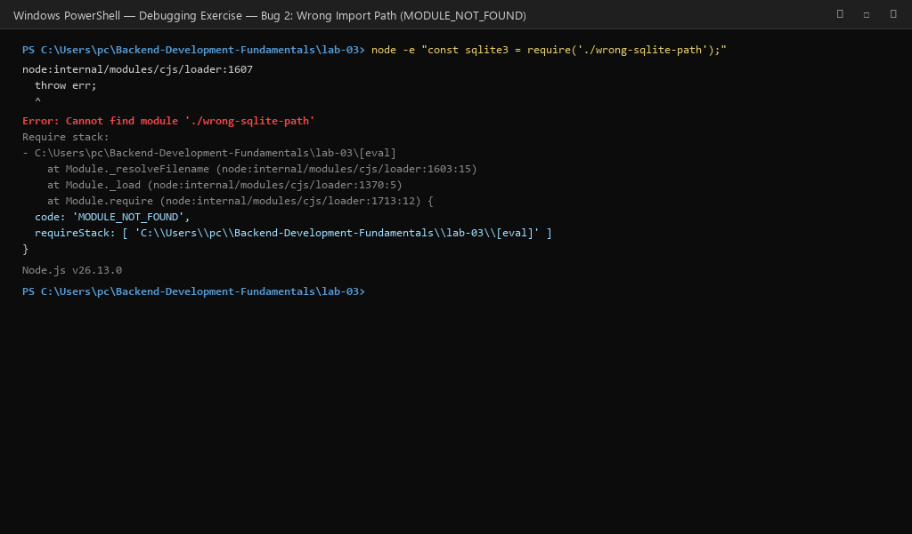

### 16. Debugging Bug 3: Table-Name Typo (`no such table: books`)
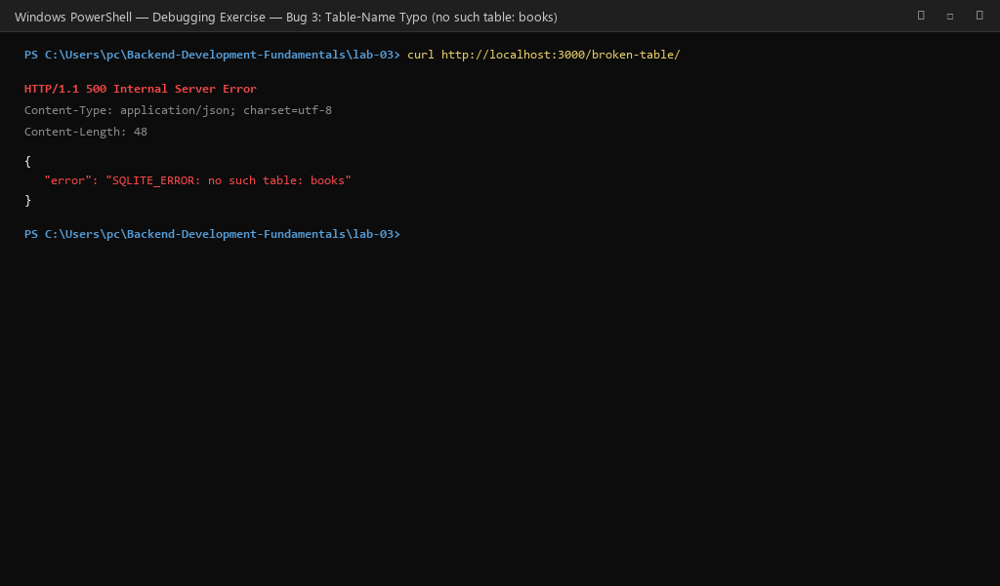

### 17. Debugging Bug 4: Missing `await` on Database Call
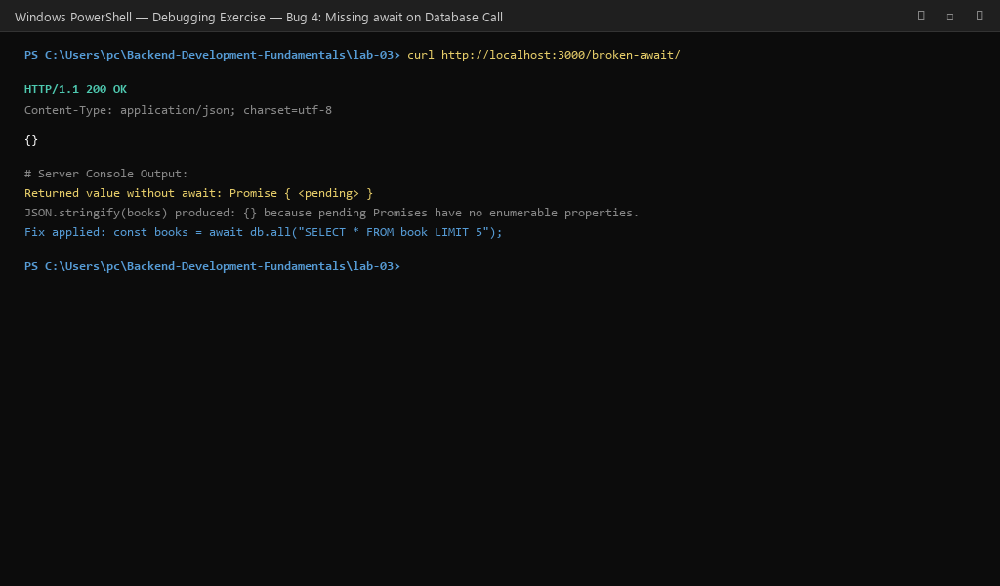

---

## 🚀 Deployment on Render

### Steps to Deploy

1. **Sign up** on [Render](https://render.com/) using your GitHub account.

2. **Create a New Web Service:**
   - Click **"New +"** → **"Web Service"**
   - Connect your GitHub repository: `Backend-Development-Fundamentals`

3. **Configure the Service:**

   | Setting | Value |
   |---|---|
   | **Name** | `backend-development-fundamentals-lab03` |
   | **Root Directory** | `lab-03` |
   | **Runtime** | `Node` |
   | **Build Command** | `npm install` |
   | **Start Command** | `npm start` |
   | **Environment Variable** | `NODE_VERSION: 20.18.0` |

4. **Deploy** and wait for the build to complete.

5. **Verify by visiting the deployed Render URLs:**
   - **Main Server / Student Info:** `GET /`
   - **GET All Books:** `GET /books/`
   - **GET Search Title:** `GET /books/?search_q=JavaScript`
   - **GET Sort by Price:** `GET /books/?order_by=price&order=DESC`
   - **GET Pagination:** `GET /books/?limit=3&offset=3`
   - **GET Price Filter:** `GET /books/?min_price=400&max_price=800`
   - **GET Combined Filters:** `GET /books/?search_q=the&min_price=200&max_price=900&order_by=price&order=DESC&limit=4&offset=0`
   - **GET Single Book (ID 1):** `GET /books/1/`
   - **GET 404 Error Test (ID 999):** `GET /books/999/`

---

## 🐛 Problems Faced and Solutions (Debugging Exercise)

| Problem | Solution |
|---|---|
| **Bug 1: Port Conflict (`EADDRINUSE`)** | Made port configurable via `process.env.PORT || 3000` and attached `server.on("error", ...)` handler to print friendly guidance instead of crashing. |
| **Bug 2: Wrong Import Path (`MODULE_NOT_FOUND`)** | Replaced erroneous relative path with proper installed module name `require("sqlite3")` and verified `package.json`. |
| **Bug 3: Table-Name Typo (`no such table: books`)** | Aligned SQL queries to match the exact schema table name `book` (singular) rather than `books` (plural). |
| **Bug 4: Missing `await` on Database Call** | Added the `await` keyword before async database calls (`await db.all(...)`) so execution waits for the promise to resolve rather than returning an empty object `{}`. |
| **Render Linux GLIBC compatibility error** | Locked `sqlite3` to version `5.1.7` (or tested native build) and specified Node LTS `20.18.0` in `.node-version`. |

---

## 💡 Viva Questions & Answers

| Question | Answer |
| :--- | :--- |
| **What is the difference between Path and Query parameters?** | Path parameters (`req.params`) form part of the URL path and identify a specific resource (e.g. `/books/1/`). Query parameters (`req.query`) appear after `?` in key-value pairs and filter, sort, search, or paginate a collection without altering the resource identity. |
| **What does "Stateless" mean in REST architecture?** | Every HTTP request contains all context and credentials needed to fulfill it. The server stores no client session memory between requests, enabling horizontal scalability and seamless failover. |
| **What is the difference between HTTP 400 and 404?** | HTTP 400 (Bad Request) indicates client data error (missing fields, negative price, invalid query parameter). HTTP 404 (Not Found) indicates a well-formed request where the target URI or ID does not exist on the server. |
| **Why cannot SQL `ORDER BY` be parameterized with `?` placeholders?** | Placeholders only bind literal data values (strings, numbers). The SQL engine does not permit binding identifiers (columns, tables) or keywords (`ASC`/`DESC`). Whitelisting allowed column names in JavaScript is required to maintain security against SQL injection. |
| **Why do parameterized queries prevent SQL injection?** | Parameterized queries separate SQL logic from user data. The database compiles the query syntax first and treats parameter inputs strictly as literal values, rendering SQL injection code inert. |

---

## 🏁 Conclusion

In this lab, I learned:

1. **How to implement dynamic query parameters** (`search_q`, `order_by`, `order`, `limit`, `offset`, `min_price`, `max_price`) and build flexible SQL queries safely.
2. **How to prevent SQL injection** through strict JavaScript whitelisting and parameterized placeholders (`?`).
3. **How to enforce data validation** on request bodies and query parameters, returning consistent JSON error messages and proper status codes (200, 201, 400, 404, 500).
4. **How to diagnose and resolve critical backend errors** (port conflicts, missing modules, table name mismatches, and unresolved asynchronous promises).
5. **How to verify database state** with the SQLite CLI and automate testing using an isolated test runner and Postman collections.

---

## 👤 Author

**SRIMURTHI ASHISH** — 252U1R1233 — S-016 — Aurora University
