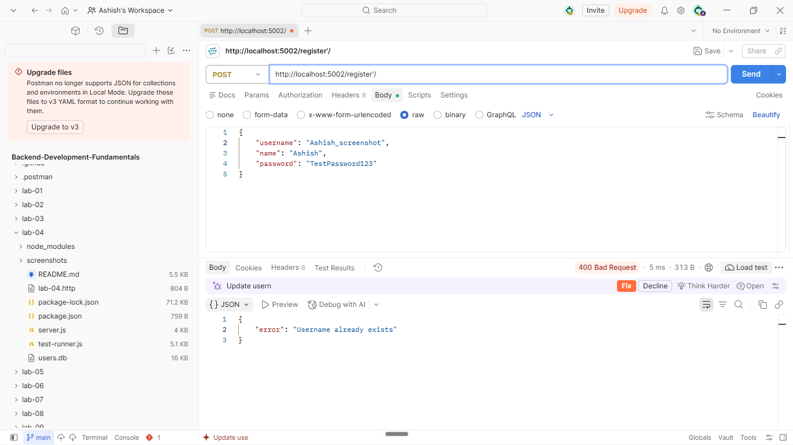
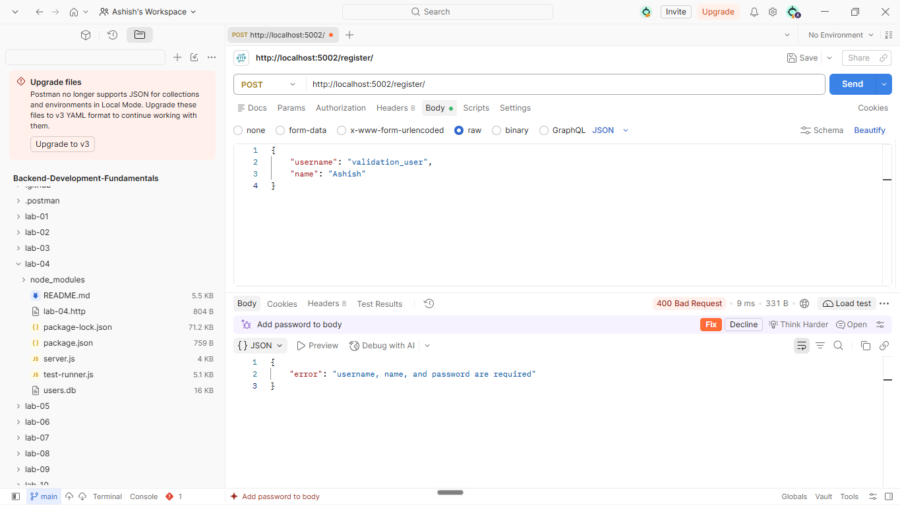
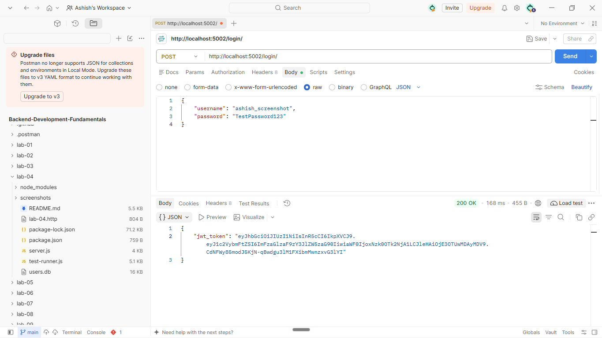
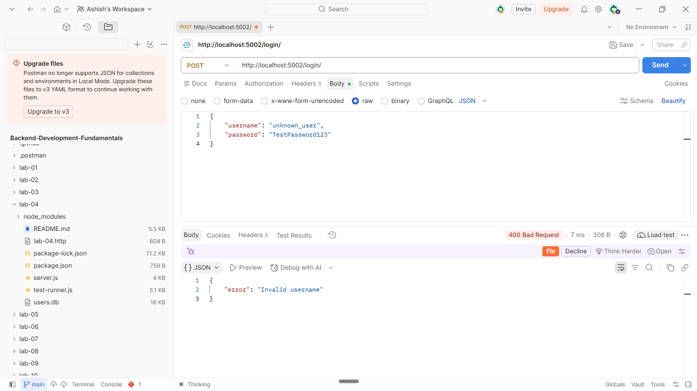
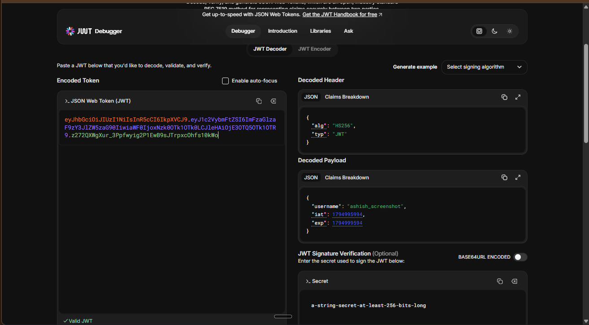

# Lab 04: User Registration, Login, and JWT Authentication

## Student Information

| Field               | Details                                                          |
| ------------------- | ---------------------------------------------------------------- |
| Student Name        | SRIMURTHI ASHISH                                                 |
| Registration Number | 252U1R1233                                                       |
| Section             | S-016                                                            |
| Course              | Backend Development Fundamentals                                 |
| Academic Year       | Year II, Term II                                                 |
| University          | Aurora University                                                |
| Faculty Name        | Yugundhar Gurjalwar                                              |
| Lab Number          | Lab 04                                                           |
| Lab Title           | User Registration, Login, and JWT Authentication                 |
| Module              | Secure Authentication, Password Hashing, and Token Authorization |

---

## 1. Project Title

**Lab 04: Secure User Registration, Password Hashing with bcrypt, and JWT Authentication in Express and SQLite**

---

## 2. Objective

The primary objective of this laboratory project is to implement, test, and document a secure, stateless authentication backend using Node.js, Express, SQLite, bcrypt, and JSON Web Tokens (JWT).

Specific technical objectives include:
- Designing and initializing an embedded relational database schema (`users`) with `PRIMARY KEY`, `NOT NULL`, and `UNIQUE` constraints.
- Implementing a user registration endpoint (`POST /register/`) with strict input validation, duplicate username rejection, and one-way password hashing using `bcrypt.hash()`.
- Implementing a user login endpoint (`POST /login/`) that verifies credentials using `bcrypt.compare()`.
- Generating cryptographically signed JSON Web Tokens (`jwt.sign()`) upon successful authentication, containing minimal identity claims and standard expiration.
- Ensuring zero credential leakage across all API responses, token payloads, and documentation.
- Building an isolated automated test suite that validates route handlers and database constraints deterministically.

---

## 3. Concepts Covered

### Authentication vs. Authorization
- **Authentication** verifies identity (who the user is), such as checking credentials during login.
- **Authorization** verifies permissions (what an authenticated user is permitted to do). This lab focuses on authentication.

### Password Hashing vs. Encryption
- **Hashing (One-Way):** A mathematical transformation that converts plaintext into a fixed-length string (digest). It is computationally infeasible to invert a hash back into the original plaintext. Passwords must always be hashed so that a database breach does not expose raw credentials.
- **Encryption (Two-Way):** A reversible transformation that scrambles plaintext into ciphertext using an encryption key, allowing authorized parties with the decryption key to restore the original plaintext. Encryption is used for confidential data transmission, not password storage.

### Salting and bcrypt Cost Factors
- **Cryptographic Salt:** A randomly generated byte sequence appended to each password before hashing. Salting ensures that identical passwords produce completely different hash outputs, protecting against precomputed rainbow table attacks.
- **Adaptive Cost Factor:** The bcrypt cost factor (set to `10` in this lab) defines the key expansion work scale ($2^{\text{cost}}$ iterations in the underlying Eksblowfish algorithm), requiring $2^{10} = 1,024$ rounds. This work factor can be increased over time as hardware speeds improve to keep brute-force guessing computationally prohibitive.

### Stateless Token-Based Authentication
- Instead of maintaining session state in server memory or database tables, the server issues a signed JSON Web Token (JWT) to the client upon successful login.
- The client attaches the token to subsequent requests. The server validates the token cryptographically using a signing secret.

### Defensive Database Design
- **Data Integrity Constraints:** The SQLite schema enforces `UNIQUE` on usernames and `NOT NULL` on required fields.
- **Parameterized SQL Queries:** Parameter placeholders (`?`) separate SQL command syntax from user-supplied data, helping protect against SQL injection vulnerabilities.

### Role of CORS
- **Cross-Origin Resource Sharing (CORS)** is a browser security mechanism that governs whether web applications running at one origin can access resources from a different origin. It is not an authentication or authorization mechanism, nor does it secure endpoints against non-browser clients (such as curl or Postman).

---

## 4. Technologies and Dependencies

| Package / Tool | Version | Role in Lab 04 |
|---|---|---|
| **Node.js** | v18+ / v20+ / v26+ | Asynchronous JavaScript runtime environment (tested on v26.13.0) |
| **Express.js** (`express`) | `^5.3.0` | HTTP routing framework and middleware pipeline |
| **SQLite3** (`sqlite3`) | `^6.0.1` | Native SQLite driver for embedded relational database storage |
| **SQLite Bridge** (`sqlite`) | `^5.1.1` | Promise-based wrapper around `sqlite3` enabling `async`/`await` |
| **bcrypt** (`bcrypt`) | `^6.0.0` | Password hashing and verification library using Eksblowfish |
| **jsonwebtoken** (`jsonwebtoken`) | `^9.0.2` | RFC 7519 implementation for signing and verifying tokens |
| **cors** (`cors`) | `^2.8.6` | Middleware enabling browser cross-origin requests |
| **dotenv** (`dotenv`) | `^18.0.9` | Environment variable loader |
| **nodemon** (`nodemon`) | `^3.1.14` | Development utility for auto-restarting the server on file edits |
| **Node.js Assert** (`node:assert`) | Built-in | Native assertion library powering the automated test harness |

---

## 5. Project Directory Structure

```text
lab-04/
|-- .gitignore              # Excludes dependencies, logs, and SQLite database files
|-- lab-04.http             # REST Client request suite (7 executable scenarios)
|-- package.json            # Project manifest, npm scripts, and dependency definitions
|-- package-lock.json       # Exact dependency lockfile for reproducible builds
|-- README.md               # Technical, architectural, and submission documentation
|-- server.js               # Express application server and route implementations
|-- test-runner.js          # In-process automated test suite with isolated SQLite database
|-- screenshots/            # Verified visual evidence from testing
|   |-- 01-register-success.png        # HTTP 201 Created response
|   |-- 02-register-duplicate.png      # HTTP 400 Bad Request duplicate rejection
|   |-- 03-register-validation.png     # HTTP 400 Bad Request missing fields validation
|   |-- 04-login-success.png           # HTTP 200 OK with jwt_token response
|   |-- 05-login-invalid-user.png      # HTTP 400 Bad Request unknown username error
|   |-- 06-login-wrong-password.png    # HTTP 400 Bad Request invalid password error
|   |-- 07-database-password-hash.png  # SQLite database inspection showing bcrypt hashes
|   `-- 08-jwt-decoded.png             # jwt.io debugger showing decoded header and payload
`-- submission/             # Formal evaluation documents
    |-- .template-style.json                   # Report template metadata
    |-- Lab_04_Registration_Login_JWT_Report.docx  # Editable academic report
    `-- Lab_04_Registration_Login_JWT_Report.pdf   # Submission-ready report
```

---

## 6. Prerequisites

Ensure your development environment meets these requirements:

1. **Node.js:** v18.x LTS, v20.x LTS, or later installed.
2. **npm:** v9.x or later installed (on Windows PowerShell, execute using `npm.cmd`).
3. **Git:** Version control client installed.
4. **API Client:** VS Code REST Client extension or Postman Desktop App.

Verify installed versions:

```powershell
node --version
npm.cmd --version
git --version
```

---

## 7. Installation Instructions

Execute these commands from Windows PowerShell:

```powershell
# Navigate to the lab-04 directory
cd C:\Users\pc\Backend-Development-Fundamentals\lab-04

# Install declared dependencies
npm.cmd install
```

`npm.cmd install` resolves the dependency tree defined in `package.json`, installs packages into `node_modules/`, and verifies integrity against `package-lock.json`.

---

## 8. Commands to Start the Application

### Development Mode (with automatic reload on file changes)
```powershell
npm.cmd run dev
```

### Standard Start Mode
```powershell
npm.cmd start
```

### Direct Node.js Execution
```powershell
node server.js
```

### Server URL and Port
- **Configured Port:** `5002` (configurable via `process.env.PORT`).
- **Base URL:** `http://localhost:5002`
- **Database Path:** `users.db` in the `lab-04` directory (configurable via `process.env.DB_PATH`).

Expected startup output:
```text
Lab 04 authentication API listening on port 5002
```

---

## 9. Database Structure

The server automatically initializes an embedded SQLite database (`users.db`) on startup. It executes the following Data Definition Language (DDL) command if the table does not exist:

```sql
CREATE TABLE IF NOT EXISTS users (
  id INTEGER PRIMARY KEY AUTOINCREMENT,
  username TEXT NOT NULL UNIQUE,
  name TEXT NOT NULL,
  password TEXT NOT NULL
);
```

### Schema Column Specifications

| Column Name | SQL Type | Constraints | Purpose | Security Protection |
|---|---|---|---|---|
| `id` | `INTEGER` | `PRIMARY KEY AUTOINCREMENT` | Unique row identifier | Prevents row collisions |
| `username` | `TEXT` | `NOT NULL UNIQUE` | Unique user account handle | Enforces account uniqueness at database level |
| `name` | `TEXT` | `NOT NULL` | User display name | Trimmed and validated before storage |
| `password` | `TEXT` | `NOT NULL` | 60-character bcrypt hash string | Passwords are never stored as plaintext |

All queries in `server.js` use parameterized statements with `?` placeholders:

```javascript
// Parameterized user lookup
const user = await db.get(
  "SELECT username, password FROM users WHERE username = ?",
  [username.trim()]
);

// Parameterized user insertion
await db.run(
  "INSERT INTO users (username, name, password) VALUES (?, ?, ?)",
  [username.trim(), name.trim(), passwordHash]
);
```

---

## 10. Registration Endpoint Documentation

- **Path:** `/register/`
- **HTTP Method:** `POST`
- **Content-Type:** `application/json`
- **Purpose:** Registers a new user, hashes their password, and saves the record in SQLite.

### Request Body Parameters

| Field | Type | Required | Validation Rule |
|---|---|---|---|
| `username` | `string` | Yes | Non-empty string after trimming. Must be unique. |
| `name` | `string` | Yes | Non-empty string after trimming. |
| `password` | `string` | Yes | Non-empty string after trimming. Hashed before storage. |

### Response Behaviors
- **`201 Created`**: User created successfully. Password and password hash are omitted from response.
- **`400 Bad Request`**: Missing required fields OR duplicate username already exists.
- **`500 Internal Server Error`**: Unexpected database failure (masked with generic error message).

---

## 11. Login Endpoint Documentation

- **Path:** `/login/`
- **HTTP Method:** `POST`
- **Content-Type:** `application/json`
- **Purpose:** Authenticates user credentials and issues a signed JSON Web Token.

### Request Body Parameters

| Field | Type | Required | Validation Rule |
|---|---|---|---|
| `username` | `string` | Yes | Registered user handle. |
| `password` | `string` | Yes | Plaintext password tested against stored hash. |

### Verification Logic
1. Validates that both `username` and `password` are non-empty strings.
2. Queries the database for the given username. If not found, returns HTTP `400 Bad Request` (`{"error": "Invalid username"}`).
3. Calls `bcrypt.compare(password, user.password)` to verify the candidate password against the stored bcrypt hash.
4. If the comparison fails, returns HTTP `400 Bad Request` (`{"error": "Invalid password"}`).
5. If valid, signs a JWT containing only `{ username: user.username }` with a 1-hour expiration.
6. Returns HTTP `200 OK` with `{ "jwt_token": "<jwt-token>" }`.

---

## 12. Request and Response Examples

### 1. Successful Registration
**Request:**
```http
POST /register/ HTTP/1.1
Host: localhost:5002
Content-Type: application/json

{
  "username": "ashish",
  "name": "Ashish",
  "password": "ExamplePassword123"
}
```
**Response (`201 Created`):**
```json
{
  "message": "User created successfully"
}
```

---

### 2. Duplicate Username Registration Attempt
**Request:**
```http
POST /register/ HTTP/1.1
Host: localhost:5002
Content-Type: application/json

{
  "username": "ashish",
  "name": "Ashish Duplicate",
  "password": "ExamplePassword123"
}
```
**Response (`400 Bad Request`):**
```json
{
  "error": "Username already exists"
}
```

---

### 3. Missing Registration Fields
**Request:**
```http
POST /register/ HTTP/1.1
Host: localhost:5002
Content-Type: application/json

{
  "username": "newuser",
  "name": "Incomplete User"
}
```
**Response (`400 Bad Request`):**
```json
{
  "error": "username, name, and password are required"
}
```

---

### 4. Successful Login
**Request:**
```http
POST /login/ HTTP/1.1
Host: localhost:5002
Content-Type: application/json

{
  "username": "ashish",
  "password": "ExamplePassword123"
}
```
**Response (`200 OK`):**
```json
{
  "jwt_token": "<jwt-token>"
}
```

---

### 5. Login with Unknown Username
**Request:**
```http
POST /login/ HTTP/1.1
Host: localhost:5002
Content-Type: application/json

{
  "username": "unknown-user-999",
  "password": "ExamplePassword123"
}
```
**Response (`400 Bad Request`):**
```json
{
  "error": "Invalid username"
}
```

---

### 6. Login with Incorrect Password
**Request:**
```http
POST /login/ HTTP/1.1
Host: localhost:5002
Content-Type: application/json

{
  "username": "ashish",
  "password": "WrongPassword123"
}
```
**Response (`400 Bad Request`):**
```json
{
  "error": "Invalid password"
}
```

---

### 7. Login with Missing Credentials
**Request:**
```http
POST /login/ HTTP/1.1
Host: localhost:5002
Content-Type: application/json

{
  "username": "ashish"
}
```
**Response (`400 Bad Request`):**
```json
{
  "error": "username and password are required"
}
```

---

### Fallback: Unmapped Route
**Request:**
```http
GET /api/unknown HTTP/1.1
Host: localhost:5002
```
**Response (`404 Not Found`):**
```json
{
  "error": "Route not found"
}
```

---

## 13. Validation and Error Handling

| Condition | Handled By | HTTP Status | Response Body |
|---|---|---|---|
| Missing registration fields | `requiredString()` validation check | `400 Bad Request` | `{"error": "username, name, and password are required"}` |
| Duplicate username | Pre-check query + `SQLITE_CONSTRAINT_UNIQUE` catch | `400 Bad Request` | `{"error": "Username already exists"}` |
| Missing login fields | `requiredString()` validation check | `400 Bad Request` | `{"error": "username and password are required"}` |
| Unregistered username | Database query returned no matching row | `400 Bad Request` | `{"error": "Invalid username"}` |
| Incorrect password | `bcrypt.compare()` returned `false` | `400 Bad Request` | `{"error": "Invalid password"}` |
| Undefined route | Centralized Express fallback middleware | `404 Not Found` | `{"error": "Route not found"}` |
| Unhandled database error | Route `try/catch` block | `500 Internal Server Error` | `{"error": "Internal server error"}` |

---

## 14. JWT Explanation

A JSON Web Token (JWT) is a compact, URL-safe token format consisting of three parts separated by periods (`.`):

```text
<base64-header> . <base64-payload> . <signature>
```

### 1. Header
Identifies the token type and cryptographic signing algorithm:
```json
{
  "alg": "HS256",
  "typ": "JWT"
}
```

### 2. Payload (Claims)
Contains user claims and standard timestamps:
```json
{
  "username": "ashish",
  "iat": 1731944400,
  "exp": 1731948000
}
```
- `username`: Custom application claim identifying the authenticated user.
- `iat`: "Issued At" Unix epoch timestamp.
- `exp`: "Expiration Time" Unix epoch timestamp (set to 1 hour via `{ expiresIn: "1h" }`).

> **Important Security Principle:** A JWT is **digitally signed, not encrypted**. The payload is Base64Url-encoded and can be easily read by anyone holding the token. Therefore, **passwords, password hashes, and sensitive secrets must never be placed in a JWT payload**.

### 3. Signature
The signature is generated by taking the encoded header, encoded payload, and a secret key, then applying the HMAC-SHA256 algorithm:

```text
Signature = HMACSHA256(base64Url(Header) + "." + base64Url(Payload), <development-secret>)
```

The signature prevents tampering: if any party alters the payload (such as changing the username claim), the signature verification fails.

---

## 15. Testing Instructions

### Automated In-Process Test Runner
The project includes a standalone automated test harness in `test-runner.js`:

```powershell
# From the lab-04 directory:
npm.cmd test
```

#### Test Runner Architecture
- **In-Process Dispatch:** Dispatches requests directly to Express route handlers without binding to a local network port, preventing TCP port conflicts.
- **Database Isolation:** Creates an isolated temporary SQLite database in the system temp directory (`os.tmpdir()/lab-04-XXXXXX/users.db`) for each test run.
- **Zero Pollution:** Safely closes database handles and deletes temporary test directories in a `finally` block, leaving the persistent `users.db` completely untouched.

### Manual Testing with Postman
1. Start the server: `npm.cmd start`.
2. Send `POST http://localhost:5002/register/` with `username`, `name`, and `password`. Verify HTTP 201 Created.
3. Resend the exact same request. Verify HTTP 400 Bad Request with `"Username already exists"`.
4. Send `POST http://localhost:5002/login/` with matching credentials. Verify HTTP 200 OK and receipt of `jwt_token`.
5. Test invalid username and incorrect password requests. Verify HTTP 400 Bad Request in both cases.
6. Inspect the received token on [jwt.io](https://jwt.io) to verify header and username claim.

---

## 16. Test Results Based on Actual Execution

Actual execution of `npm.cmd test` inside `lab-04`:

```text
> lab-04@1.0.0 test
> node test-runner.js

PASS user table initializes with required unique columns
PASS successful registration returns 201 without password/hash
PASS duplicate username returns 400
PASS registration missing username returns 400
PASS registration missing name returns 400
PASS registration missing password returns 400
PASS database stores a bcrypt hash and no plaintext password
PASS successful login returns JWT with only username application claim
PASS unknown username returns 400 and no token
PASS incorrect password returns 400 and no token
PASS login without credentials returns 400

11 passed, 0 failed.
```

### Coverage Breakdown

| # | Assertion | Verification Target | Status |
|---|---|---|---|
| 1 | Table initialization | Verifies `users` table columns, NOT NULL constraints, and unique index | PASS |
| 2 | Successful registration | Verifies HTTP 201 response and confirms no password/hash leakage | PASS |
| 3 | Duplicate username | Verifies HTTP 400 rejection on duplicate username insertion | PASS |
| 4 | Missing username | Verifies HTTP 400 rejection when username is omitted | PASS |
| 5 | Missing name | Verifies HTTP 400 rejection when name is omitted | PASS |
| 6 | Missing password | Verifies HTTP 400 rejection when password is omitted | PASS |
| 7 | Password hash storage | Queries SQLite and verifies stored password matches bcrypt format `/^\$2[aby]\$/` | PASS |
| 8 | Successful login | Verifies HTTP 200, JWT structure, username claim, and signature validity | PASS |
| 9 | Unknown username | Verifies HTTP 400 and ensures no token is returned | PASS |
| 10 | Incorrect password | Verifies HTTP 400 and ensures no token is returned | PASS |
| 11 | Missing login credentials | Verifies HTTP 400 rejection when login credentials are missing | PASS |

---

## 17. Screenshot Evidence

All screenshot evidence files are located in `screenshots/` and verified:

### 1. Successful User Registration (HTTP 201 Created)
Shows successful user creation via `POST /register/` returning HTTP `201 Created`:


---

### 2. Duplicate Username Rejection (HTTP 400 Bad Request)
Demonstrates rejection of duplicate username registrations:



---

### 3. Missing Registration Fields Validation (HTTP 400 Bad Request)
Demonstrates rejection when required input parameters are omitted:



---

### 4. Successful Login with JWT Issuance (HTTP 200 OK)
Shows successful authentication returning HTTP `200 OK` with a signed `jwt_token`:



---

### 5. Login Rejection for Unknown Username (HTTP 400 Bad Request)
Demonstrates rejection when an unregistered username is submitted:



---

### 6. Login Rejection for Incorrect Password (HTTP 400 Bad Request)
Demonstrates credential verification failure when an incorrect password is provided:


---

### 7. SQLite Database Table Inspecting Password Hashes
Database inspection confirming passwords are saved strictly as salted bcrypt hashes:


---

### 8. Decoded JWT Structure (jwt.io)
Verification of the signed token inside the JWT debugger displaying header and username claim:



---

### Formal Submission Deliverables
- [Lab 04 Report (DOCX)](./submission/Lab_04_Registration_Login_JWT_Report.docx)
- [Lab 04 Report (PDF)](./submission/Lab_04_Registration_Login_JWT_Report.pdf)

---

## 18. Security Considerations

1. **Passwords are Never Plaintext:** Plaintext passwords are never logged, stored, or returned. Hashes are generated using bcrypt with salt factor 10.
2. **JWT Payloads are Visible:** JWT payloads are Base64Url-encoded, not encrypted. Passwords and sensitive secrets are never placed in the payload.
3. **Environment-Specific Secrets:** In production, signing keys must be loaded from secure environment variables (`process.env.JWT_SECRET`) rather than hard-coded constants.
4. **Parameterized SQL Queries:** All SQL queries use parameter placeholders (`?`), preventing user input from altering query structure.
5. **User Enumeration Awareness:** The lab distinguishes between `"Invalid username"` and `"Invalid password"` to test specific error handling paths. In high-security production environments, generic messages (such as `"Invalid username or password"`) are recommended to prevent account enumeration.

---

## 19. Known Limitations

- **Local Academic Project:** The application is configured for local evaluation on `http://localhost:5002` and is not deployed to cloud infrastructure.
- **Hardcoded Development Secret:** Uses a development signing secret placeholder for reproducible academic grading.
- **Embedded SQLite Storage:** The single-file database (`users.db`) is ideal for local development but is not intended for horizontally scaled cloud environments.
- **Stateless Expiration without Revocation:** Issued JWTs remain valid until their 1-hour expiration timestamp; no server-side token revocation or blocklist is implemented.
- **Transitive Dependency Advisories:** `npm.cmd audit` reports 10 transitive ReDoS advisories in development tooling (`nodemon` -> `chokidar` -> `picomatch`, `sqlite3` -> `node-gyp` -> `tinyglobby` -> `picomatch`). Destructive `npm audit fix --force` was avoided to preserve stability and avoid breaking major version changes in dev tooling.

---

## 20. Conclusion

Lab 04 establishes a fully functional, secure user registration and login service adhering to modern backend principles. Passwords are protected using salted bcrypt hashes, and authenticated users receive cryptographically verifiable JSON Web Tokens containing minimal identity claims. All 11 automated test assertions pass deterministically, and complete screenshot and report deliverables are verified for academic submission.
