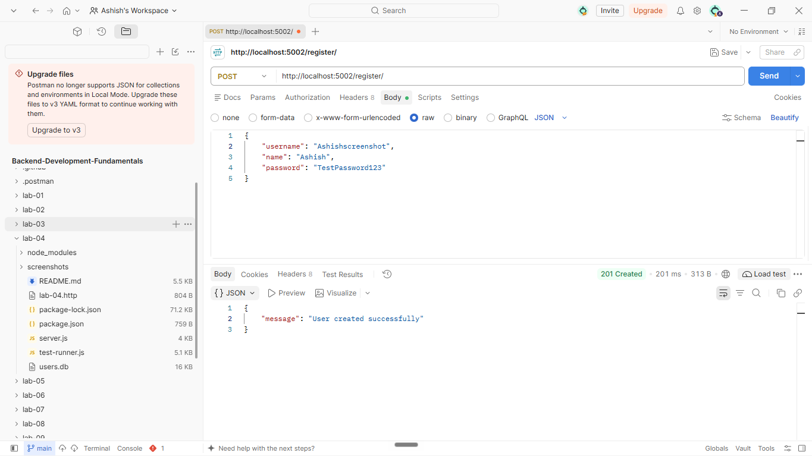
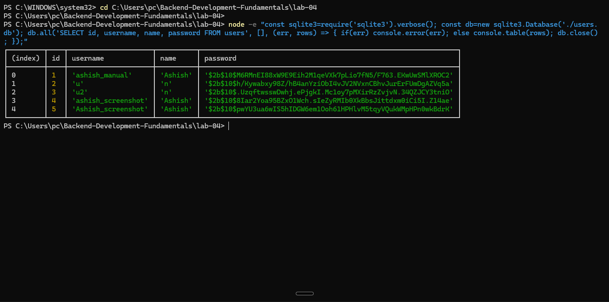

# Lab 04: User Registration, Login, and JWT Authentication

**Student:** SRIMURTHI ASHISH
**Registration Number:** 252U1R1233 | **Section:** S-016
**Course:** Backend Development Fundamentals | **Year II, Term II**
**University:** Aurora University | **Faculty:** Joel Prashanth D
**Module:** Secure Authentication, Password Hashing, and Token Authorization

---

## 1. Project Title

**Lab 04: Secure User Registration, Password Hashing with bcrypt, and JWT Authentication in Express and SQLite**

---

## 2. Lab Objective

The primary objective of this laboratory project is to build and evaluate a secure, stateless authentication backend using Node.js, Express, SQLite, bcrypt, and JSON Web Tokens (JWT).

Key academic and technical goals include:
- Designing and initializing an embedded relational database schema with data integrity constraints (`PRIMARY KEY`, `NOT NULL`, `UNIQUE`).
- Implementing user registration (`POST /register/`) with input validation and duplicate prevention.
- Implementing one-way password hashing using `bcrypt.hash()` with an adaptive work factor before persisting credentials to storage.
- Implementing user login (`POST /login/`) with verification via `bcrypt.compare()`.
- Generating cryptographically signed JSON Web Tokens (`jwt.sign()`) upon successful authentication containing only minimal identity claims.
- Ensuring zero credential leakage across all API responses and token payloads.
- Creating an isolated, automated test suite to verify route handlers and schema constraints deterministically.

---

## 3. What This Application Does

This application provides a backend RESTful authentication service for client applications. It manages the complete credential lifecycle across registration and login:

```text
[ Client Application ]
       |
       +---> 1. POST /register/ { username, name, password } ------------+
       |                                                                 |
       |    [ Server validates fields ]                                  |
       |    [ Server checks username uniqueness in SQLite ]             |
       |    [ bcrypt hashes plaintext password (10 salt rounds) ]        |
       |    [ SQLite stores: username, name, password_hash ]             |
       |                                                                 |
       |<--- 201 Created { "message": "User created successfully" } -----+
       |
       +---> 2. POST /login/ { username, password } ---------------------+
       |                                                                 |
       |    [ Server checks user existence in SQLite ]                   |
       |    [ bcrypt compares candidate password with stored hash ]      |
       |    [ Server signs JWT containing { username } payload ]         |
       |                                                                 |
       |<--- 200 OK { "jwt_token": "eyJhbGciOi..." } --------------------+
```

1. **User Registration:**
   - Validates that `username`, `name`, and `password` are provided as non-empty strings.
   - Queries the database to prevent duplicate account registration.
   - Transforms the plain text password into an irreversible cryptographic hash using `bcrypt`.
   - Stores the user record safely in SQLite and returns HTTP `201 Created`.
   - Never exposes passwords or password hashes in the response.

2. **User Authentication (Login):**
   - Validates incoming credentials.
   - Retrieves the registered user record by `username`.
   - Rejects non-existent usernames with HTTP `400 Bad Request`.
   - Validates the password against the stored bcrypt hash using `bcrypt.compare()`.
   - Rejects mismatched passwords with HTTP `400 Bad Request`.
   - Generates a cryptographically signed JWT with a 1-hour expiration.
   - Returns the token in the response body as `{ "jwt_token": "<token>" }`.

3. **Defensive Routing:**
   - Parameterizes all SQL queries to eliminate SQL injection risks.
   - Enforces unique constraints at both the application logic level and the database schema level.
   - Catches unknown paths with a global 404 JSON handler.
   - Masks internal database runtime exceptions with generic 500 error responses.

---

## 4. Technologies Used

| Technology / Package | Version | Purpose in Lab 04 |
|---|---|---|
| **Node.js** | v18+ / v20+ / v26+ | Asynchronous event-driven JavaScript runtime environment |
| **Express.js** (`express`) | `^5.3.0` | Minimalist web framework for routing and middleware management |
| **SQLite3** (`sqlite3`) | `^6.0.1` | Native SQLite driver for embedded relational database storage |
| **SQLite Bridge** (`sqlite`) | `^5.1.1` | Promise-based wrapper around `sqlite3` enabling async/await queries |
| **bcrypt** (`bcrypt`) | `^6.0.0` | Adaptive password hashing function and verification utility |
| **jsonwebtoken** (`jsonwebtoken`) | `^9.0.2` | RFC 7519 implementation for signing and verifying JSON Web Tokens |
| **CORS** (`cors`) | `^2.8.6` | Cross-Origin Resource Sharing middleware enabling external access |
| **dotenv** (`dotenv`) | `^18.0.9` | Environment variable management from `.env` files |
| **Nodemon** (`nodemon`) | `^3.1.14` | Development tool that monitors file changes and restarts the server |
| **Postman / REST Client** | Latest | HTTP client tools used for API interaction and evidence capture |

---

## 5. Project Folder Structure

The project is structured cleanly to separate runtime code, automated tests, evidence screenshots, and academic submission documents:

```text
lab-04/
|-- .gitignore              # Excludes node_modules, .env, and runtime SQLite databases
|-- lab-04.http             # Visual Studio Code REST Client test request file (7 scenarios)
|-- package.json            # Project manifest, script commands, and dependencies
|-- package-lock.json       # Deterministic dependency tree lockfile
|-- README.md               # Complete technical, architectural, and educational documentation
|-- server.js               # Main Express application, database initialization, and routes
|-- test-runner.js          # In-process automated test suite with isolated SQLite database
|-- screenshots/            # Visual proof of API responses, database records, and token decoding
|   |-- 01-register-success.png        # HTTP 201 Created response in Postman
|   |-- 02-register-duplicate.png      # HTTP 400 Bad Request duplicate rejection
|   |-- 03-register-validation.png     # HTTP 400 Bad Request missing fields validation
|   |-- 04-login-success.png           # HTTP 200 OK with jwt_token response
|   |-- 05-login-invalid-user.png      # HTTP 400 Bad Request unknown username error
|   |-- 06-login-wrong-password.png    # HTTP 400 Bad Request invalid password error
|   |-- 07-database-password-hash.png  # SQLite database browser showing bcrypt hash storage
|   `-- 08-jwt-decoded.png             # jwt.io debugger showing decoded header and payload
`-- submission/             # Formal evaluation reports
    |-- .template-style.json                   # Report template metadata
    |-- Lab_04_Registration_Login_JWT_Report.docx  # Editable academic report
    `-- Lab_04_Registration_Login_JWT_Report.pdf   # Official submission report
```

---

## 6. Prerequisites

Before installing and executing this project, ensure your environment meets the following requirements:

1. **Node.js:** Version `18.x`, `20.x`, or higher installed. (Verified compatible with Node.js `v26.13.0`).
2. **npm:** Version `9.x` or higher installed. (On Windows, use `npm.cmd` in PowerShell/CMD).
3. **C/C++ Build Tooling (Optional for prebuilt binaries):** Standard Python 3 and Visual C++ Build Tools if native compilation is triggered for `sqlite3` or `bcrypt`. (Precompiled binaries are provided by default).
4. **Git:** For source version control.
5. **API Client:** Either the VS Code REST Client Extension or Postman Desktop App.

To verify your installed versions on Windows PowerShell, run:

```powershell
node --version
npm.cmd --version
git --version
```

---

## 7. Installation Instructions

Follow these exact steps from your terminal to install the project dependencies:

```powershell
# 1. Open Windows PowerShell or your preferred command line
# 2. Navigate to the lab-04 directory inside the repository
cd C:\Users\pc\Backend-Development-Fundamentals\lab-04

# 3. Install project dependencies using npm.cmd
npm.cmd install
```

### What happens during installation?
- `npm.cmd install` reads `package.json` and `package-lock.json`.
- Installs production dependencies (`express`, `bcrypt`, `jsonwebtoken`, `sqlite`, `sqlite3`, `cors`, `dotenv`) and developer dependencies (`nodemon`) into `node_modules/`.
- Verifies binary integrity using SHA-512 integrity hashes recorded in `package-lock.json`.

---

## 8. How to Start the Server

You can run the server in either development mode (with auto-reload) or standard production mode:

### Option A: Development Mode (Recommended for testing and editing)
Uses `nodemon` to automatically restart the server whenever you edit `server.js`:

```powershell
npm.cmd run dev
```

### Option B: Standard Start Mode
Runs the server directly through Node.js:

```powershell
npm.cmd start
```

### Option C: Direct Node Execution
```powershell
node server.js
```

### Expected Startup Output
When the database connection opens and the server starts listening, you will observe:

```text
Lab 04 authentication API listening on port 5002
```

---

## 9. Server URL and Port

- **Configured Port:** `5002` (configurable via the `PORT` environment variable).
- **Default Base URL:** `http://localhost:5002`
- **Network Interface:** `127.0.0.1:5002` (Localhost loopback).
- **Database File:** `lab-04/users.db` (created automatically upon first startup, configurable via `DB_PATH`).

---

## 10. Database Schema

The application uses an embedded **SQLite** relational database. On server startup, `initializeDatabase()` automatically checks for the existence of the `users` table and executes the following Data Definition Language (DDL) command if missing:

```sql
CREATE TABLE IF NOT EXISTS users (
  id INTEGER PRIMARY KEY AUTOINCREMENT,
  username TEXT NOT NULL UNIQUE,
  name TEXT NOT NULL,
  password TEXT NOT NULL
);
```

### Field Definitions and Constraints

| Column Name | Data Type | Constraints | Description | Security Consideration |
|---|---|---|---|---|
| `id` | `INTEGER` | `PRIMARY KEY AUTOINCREMENT` | Unique integer row identifier | Prevents row collisions |
| `username` | `TEXT` | `NOT NULL`, `UNIQUE` | Case-sensitive unique account handle | Prevents duplicate user registrations |
| `name` | `TEXT` | `NOT NULL` | Display name of the user | Sanitized before insertion |
| `password` | `TEXT` | `NOT NULL` | 60-character bcrypt cryptographic hash | **Never plaintext.** Always hashed with salt |

### Parameterized Query Security
All queries interact with the database using parameterized placeholders (`?`). Values are bound separately by SQLite, preventing attackers from injecting arbitrary SQL commands:

```javascript
// Parameterized lookup preventing SQL injection
const user = await db.get(
  "SELECT username, password FROM users WHERE username = ?",
  [username.trim()]
);

// Parameterized insertion
await db.run(
  "INSERT INTO users (username, name, password) VALUES (?, ?, ?)",
  [username.trim(), name.trim(), passwordHash]
);
```

---

## 11. Registration API Documentation

- **Path:** `/register/`
- **Method:** `POST`
- **Content-Type:** `application/json`
- **Purpose:** Creates a new user profile, verifies username availability, hashes the plaintext password, and persists the record.

### Request Headers
| Header | Value | Required |
|---|---|---|
| `Content-Type` | `application/json` | Yes |

### Request Body Parameters
| Field | Type | Required | Description |
|---|---|---|---|
| `username` | `string` | Yes | Unique login handle. Must be a non-empty string. |
| `name` | `string` | Yes | Full or display name of the user. |
| `password` | `string` | Yes | Plaintext password (will be hashed with bcrypt). |

### Response Codes and Behaviors
- **`201 Created`**: User was successfully registered.
- **`400 Bad Request`**: Any required field is missing or empty, OR the username already exists.
- **`500 Internal Server Error`**: Unexpected database error occurred.

---

## 12. Login API Documentation

- **Path:** `/login/`
- **Method:** `POST`
- **Content-Type:** `application/json`
- **Purpose:** Authenticates user credentials and issues a signed JSON Web Token upon verification.

### Request Headers
| Header | Value | Required |
|---|---|---|
| `Content-Type` | `application/json` | Yes |

### Request Body Parameters
| Field | Type | Required | Description |
|---|---|---|---|
| `username` | `string` | Yes | The registered user handle. |
| `password` | `string` | Yes | The plaintext password to test against the stored hash. |

### Verification Logic
1. Checks that both `username` and `password` are present non-empty strings.
2. Queries the `users` table for `username`. If no matching row is found, immediately returns HTTP `400 Bad Request` (`{"error": "Invalid username"}`).
3. Invokes `bcrypt.compare(password, user.password)`. If the hash check fails, returns HTTP `400 Bad Request` (`{"error": "Invalid password"}`).
4. If the check succeeds, invokes `jwt.sign()` with payload `{ username: user.username }`, secret key, and 1-hour expiration.
5. Returns HTTP `200 OK` with the token string.

---

## 13. Example Request and Response JSON

### Scenario 1: Successful Registration
**Request:**
```http
POST /register/ HTTP/1.1
Host: localhost:5002
Content-Type: application/json

{
  "username": "ashish",
  "name": "Ashish",
  "password": "ExamplePassword123"
}
```

**Response (HTTP 201 Created):**
```json
{
  "message": "User created successfully"
}
```

---

### Scenario 2: Duplicate Username Registration Attempt
**Request:**
```http
POST /register/ HTTP/1.1
Host: localhost:5002
Content-Type: application/json

{
  "username": "ashish",
  "name": "Ashish Duplicate",
  "password": "ExamplePassword123"
}
```

**Response (HTTP 400 Bad Request):**
```json
{
  "error": "Username already exists"
}
```

---

### Scenario 3: Missing Registration Fields
**Request:**
```http
POST /register/ HTTP/1.1
Host: localhost:5002
Content-Type: application/json

{
  "username": "newuser",
  "name": "Incomplete Profile"
}
```

**Response (HTTP 400 Bad Request):**
```json
{
  "error": "username, name, and password are required"
}
```

---

### Scenario 4: Successful Login
**Request:**
```http
POST /login/ HTTP/1.1
Host: localhost:5002
Content-Type: application/json

{
  "username": "ashish",
  "password": "ExamplePassword123"
}
```

**Response (HTTP 200 OK):**
```json
{
  "jwt_token": "eyJhbGciOiJIUzI1NiIsInR5cCI6IkpXVCJ9.eyJ1c2VybmFtZSI6ImFzaGlzaCIsImlhdCI6MTczMTk0NDQwMCwiZXhwIjoxNzMxOTQ4MDAwfQ.g6..."
}
```

---

### Scenario 5: Login with Unknown Username
**Request:**
```http
POST /login/ HTTP/1.1
Host: localhost:5002
Content-Type: application/json

{
  "username": "non-existent-user",
  "password": "ExamplePassword123"
}
```

**Response (HTTP 400 Bad Request):**
```json
{
  "error": "Invalid username"
}
```

---

### Scenario 6: Login with Incorrect Password
**Request:**
```http
POST /login/ HTTP/1.1
Host: localhost:5002
Content-Type: application/json

{
  "username": "ashish",
  "password": "WrongPassword999"
}
```

**Response (HTTP 400 Bad Request):**
```json
{
  "error": "Invalid password"
}
```

---

### Scenario 7: Route Not Found (404 Fallback)
**Request:**
```http
GET /api/unknown-endpoint HTTP/1.1
Host: localhost:5002
```

**Response (HTTP 404 Not Found):**
```json
{
  "error": "Route not found"
}
```

---

## 14. HTTP Status Codes

| Status Code | Meaning | When It Is Used in Lab 04 |
|---|---|---|
| **`200 OK`** | Request succeeded | Returned on successful `POST /login/` alongside `{ "jwt_token": "..." }`. |
| **`201 Created`** | Resource successfully created | Returned on successful `POST /register/` after the user is saved. |
| **`400 Bad Request`** | Client input error | Returned for missing fields, duplicate username, unknown user, or incorrect password. |
| **`404 Not Found`** | Endpoint does not exist | Returned by the centralized fallback handler when an unmapped route is requested. |
| **`500 Internal Server Error`** | Unhandled server exception | Returned if an unhandled SQLite database error or system exception occurs. |

---

## 15. Password Hashing Explanation

Understanding password storage requires clarifying the fundamental distinction between **Hashing** and **Encryption**:

### Hashing vs. Encryption

| Concept | Hashing (Used for Passwords) | Encryption (Used for Confidential Data) |
|---|---|---|
| **Directionality** | **One-Way Function** (Irreversible). It is mathematically infeasible to turn a hash back into the original password. | **Two-Way Function** (Reversible). Plaintext can be encrypted into ciphertext and decrypted back into plaintext using a key. |
| **Primary Goal** | **Integrity & Verification.** Verifies that user input matches without ever knowing or saving the original plaintext. | **Confidentiality.** Protects data during transmission or storage while allowing authorized parties with the key to recover it. |
| **Vulnerability if Stolen** | If a hashed database is breached, attackers **cannot decrypt** hashes; they must guess passwords via brute-force dictionary attacks. | If an encrypted database is breached and the decryption key is compromised, all data is immediately read in plaintext. |
| **Standard Algorithm** | **bcrypt**, Argon2id, PBKDF2, scrypt. | AES-256-GCM, RSA, ChaCha20. |

### How bcrypt Works

This lab uses **bcrypt** with a salt round factor of `10`:

```javascript
const BCRYPT_ROUNDS = 10;
const passwordHash = await bcrypt.hash(password, BCRYPT_ROUNDS);
```

1. **Cryptographic Salt:**
   - A salt is a sequence of cryptographically random bits generated specifically for each user and appended to the password before hashing.
   - **Why salt is essential:** If two users choose the same password (e.g., `Password123!`), their resulting hashes will be completely different. This protects against **rainbow table attacks** (precomputed tables of password hashes).
2. **Adaptive Cost Factor (Work Factor):**
   - The cost factor `10` represents 2^10 = 1,024 internal hashing iterations.
   - bcrypt is designed to be slow and computationally expensive, drastically impeding brute-force attempts on high-performance GPUs and ASICs.
3. **Anatomy of a bcrypt Hash String:**
   A typical bcrypt hash in SQLite appears as follows:
   ```text
   $2b$10$N9qo8uLOickgx2ZMRZoMyeIjZAgcfl7p92ldGxad68LJZdL17lhWy
   |---|--|----------------------|-----------------------------|
     |   |            |                          |
     |   |            |                          +-- 31 Characters: Hash Digest
     |   |            +-- 22 Characters: Salt
     |   +-- Cost Factor (10 = 2^10 iterations)
     +-- Algorithm Identifier ($2b$ = bcrypt)
   ```
4. **Verification with `bcrypt.compare()`:**
   - The server never extracts the original password from the hash.
   - Instead, `bcrypt.compare(candidatePassword, storedHash)` extracts the salt and work factor directly from the stored hash, hashes the candidate password using those exact parameters, and performs a constant-time comparison to prevent timing attacks.

---

## 16. JWT Structure and Explanation

A **JSON Web Token (JWT)** (RFC 7519) is a compact, URL-safe means of transferring claims between parties. A JWT consists of three parts separated by periods (`.`):

```text
JWT = Header . Payload . Signature
```

```text
eyJhbGciOiJIUzI1NiIsInR5cCI6IkpXVCJ9.eyJ1c2VybmFtZSI6ImFzaGlzaCIsImlhdCI6MTczMTk0NDQwMCwiZXhwIjoxNzMxOTQ4MDAwfQ.g6_6rG2rF...
|-----------------------------------| |------------------------------------------------------------------------| |------------|
               Header                                                Payload                                         Signature
```

### 1. Header
Contains the token metadata, including the signing algorithm and token type:
```json
{
  "alg": "HS256",
  "typ": "JWT"
}
```
*Encoded via Base64Url.*

### 2. Payload (Claims)
Contains identity claims and token validity timestamps:
```json
{
  "username": "ashish",
  "iat": 1731944400,
  "exp": 1731948000
}
```
- `username`: Application-specific claim identifying the authenticated user.
- `iat` (Issued At): Unix timestamp indicating when the token was signed.
- `exp` (Expiration Time): Unix timestamp indicating when the token expires (set to 1 hour via `{ expiresIn: "1h" }`).

> [!CAUTION]
> **Payload Visibility:** The payload is **Base64Url encoded**, NOT encrypted! Anyone with the token can decode and read its contents using tools like jwt.io. Therefore, **never store passwords, password hashes, or confidential API keys in a JWT payload**.

### 3. Signature
The signature verifies that the sender of the JWT is who it claims to be and ensures that the message was not altered in transit. It is calculated by hashing the encoded header, encoded payload, and a secret key using HMAC-SHA256:

```text
Signature = HMACSHA256(base64UrlEncode(Header) + "." + base64UrlEncode(Payload), SecretKey)
```

If an attacker modifies the username claim in the payload, the server will detect that the newly computed signature does not match the received signature, and verification will fail immediately.

---

## 17. Automated Testing Instructions and Actual Results

### Architecture of `test-runner.js`
The automated test runner is designed for complete isolation, speed, and determinism:
- **Zero Port Collisions:** It dispatches mock requests directly to Express's router stack in-process. It does not bind to a local TCP socket, allowing tests to run even if another server instance is already running on port 5002 or if loopback sockets are restricted.
- **Isolated SQLite Instance:** Each test run creates an ephemeral temporary directory (`os.tmpdir()/lab-04-XXXXXX/users.db`), runs all tests, and safely cleans up and closes database handles in a `finally` block.
- **No External Testing Framework Dependency:** Uses Node.js native `node:assert/strict`.

### Running the Test Suite
From the `lab-04` directory, run:

```powershell
npm.cmd test
```

### Actual Execution Output
```text
> lab-04@1.0.0 test
> node test-runner.js

PASS user table initializes with required unique columns
PASS successful registration returns 201 without password/hash
PASS duplicate username returns 400
PASS registration missing username returns 400
PASS registration missing name returns 400
PASS registration missing password returns 400
PASS database stores a bcrypt hash and no plaintext password
PASS successful login returns JWT with only username application claim
PASS unknown username returns 400 and no token
PASS incorrect password returns 400 and no token
PASS login without credentials returns 400

11 passed, 0 failed.
```

### Breakdown of the 11 Assertions

| # | Test Name | Target Requirement Verified |
|---|---|---|
| 1 | `user table initializes with required unique columns` | Verifies schema columns (`id`, `username`, `name`, `password`), NOT NULL constraints, and UNIQUE index. |
| 2 | `successful registration returns 201 without password/hash` | Verifies HTTP 201 Created and confirms neither password nor hash is leaked. |
| 3 | `duplicate username returns 400` | Attempts registering the same username twice; verifies HTTP 400 Bad Request. |
| 4 | `registration missing username returns 400` | Omits `username`; verifies HTTP 400 Bad Request. |
| 5 | `registration missing name returns 400` | Omits `name`; verifies HTTP 400 Bad Request. |
| 6 | `registration missing password returns 400` | Omits `password`; verifies HTTP 400 Bad Request. |
| 7 | `database stores a bcrypt hash and no plaintext password` | Queries SQLite; checks bcrypt regex `/^\$2[aby]\$/` and verifies `bcrypt.compare()` returns true. |
| 8 | `successful login returns JWT with only username application claim` | Verifies HTTP 200, checks `jwt_token`, decodes payload keys (`exp`, `iat`, `username`), and verifies signature. |
| 9 | `unknown username returns 400 and no token` | Submits unregistered username; verifies HTTP 400 and absence of token. |
| 10 | `incorrect password returns 400 and no token` | Submits invalid password; verifies HTTP 400 and absence of token. |
| 11 | `login without credentials returns 400` | Submits empty login body; verifies HTTP 400 Bad Request. |

---

## 18. Manual Postman Testing Instructions

To manually test the server using Postman:

1. **Start the API Server:**
   ```powershell
   npm.cmd start
   ```
   Ensure the console shows: `Lab 04 authentication API listening on port 5002`.

2. **Step 1: Test Successful Registration**
   - **Method:** `POST`
   - **URL:** `http://localhost:5002/register/`
   - **Headers:** `Content-Type: application/json`
   - **Body (raw JSON):**
     ```json
     {
       "username": "ashish",
       "name": "Ashish",
       "password": "ExamplePassword123"
     }
     ```
   - **Expected Status:** `201 Created`
   - **Expected Body:** `{"message":"User created successfully"}`

3. **Step 2: Test Duplicate Registration**
   - Click **Send** again with the exact same body.
   - **Expected Status:** `400 Bad Request`
   - **Expected Body:** `{"error":"Username already exists"}`

4. **Step 3: Test Missing Registration Fields**
   - Omit the `password` property.
   - **Expected Status:** `400 Bad Request`
   - **Expected Body:** `{"error":"username, name, and password are required"}`

5. **Step 4: Test Successful Login**
   - **Method:** `POST`
   - **URL:** `http://localhost:5002/login/`
   - **Body (raw JSON):**
     ```json
     {
       "username": "ashish",
       "password": "ExamplePassword123"
     }
     ```
   - **Expected Status:** `200 OK`
   - **Expected Body:** `{"jwt_token":"<signed_token_string>"}`

6. **Step 5: Test Unknown Username**
   - Change `username` to `"non-existent-user"`.
   - **Expected Status:** `400 Bad Request`
   - **Expected Body:** `{"error":"Invalid username"}`

7. **Step 6: Test Incorrect Password**
   - Change `password` to `"WrongPassword123"`.
   - **Expected Status:** `400 Bad Request`
   - **Expected Body:** `{"error":"Invalid password"}`

8. **Step 7: Inspect Decoded JWT on jwt.io**
   - Copy the `jwt_token` received in Step 4.
   - Navigate to [https://jwt.io](https://jwt.io).
   - Paste the token into the **Encoded** box and verify the decoded header (`HS256`) and payload (`username: "ashish"`).

---

## 19. Screenshots and Evidence

The following captures are authentic, unedited screenshots recorded during actual server execution and Postman testing:

### 1. Successful User Registration (HTTP 201 Created)
Shows successful user creation via `POST /register/` returning status `201 Created` and confirmation message:



---

### 2. Duplicate Username Rejection (HTTP 400 Bad Request)
Demonstrates application and database constraint protection rejecting a duplicate username:


---

### 3. Missing Registration Fields Validation (HTTP 400 Bad Request)
Demonstrates rejection when required input parameters (such as password) are omitted:


---

### 4. Successful Login with JWT Issuance (HTTP 200 OK)
Shows successful authentication via `POST /login/` returning HTTP `200 OK` with a signed `jwt_token`:


---

### 5. Login Rejection for Unknown Username (HTTP 400 Bad Request)
Demonstrates authentication failure when an unregistered username is submitted:


---

### 6. Login Rejection for Incorrect Password (HTTP 400 Bad Request)
Demonstrates credential verification failure when a valid username is provided with an incorrect password:


---

### 7. SQLite Database Table Inspecting Password Hashes
Inspection of the `users.db` SQLite table showing that passwords are stored strictly as 60-character bcrypt hashes:



---

### 8. Decoded JWT Structure (jwt.io)
Verification of the signed token inside the JWT debugger, displaying the header algorithm (`HS256`) and payload claims (`username`, `iat`, `exp`):


---

### Formal Academic Submission Deliverables
The complete lab report documents are located in the `submission/` directory:
- [Lab 04 Report (DOCX)](./submission/Lab_04_Registration_Login_JWT_Report.docx)
- [Lab 04 Report (PDF)](./submission/Lab_04_Registration_Login_JWT_Report.pdf)

---

## 20. Common Errors and Solutions

| Symptom / Error Message | Root Cause | Solution |
|---|---|---|
| `Error: listen EADDRINUSE: address already in use :::5002` | Another server instance or node process is already listening on port 5002. | Check running processes via PowerShell: `Get-NetTCPConnection -LocalPort 5002`. Stop the conflicting process with `Stop-Process -Id <PID> -Force` or configure a custom port: `$env:PORT="5003"; npm.cmd start`. |
| `SQLITE_CONSTRAINT: UNIQUE constraint failed: users.username` | Attempting to insert a username that already exists in SQLite. | Handled gracefully in `server.js` by checking `SELECT id FROM users` first and catching `SQLITE_CONSTRAINT_UNIQUE`, returning HTTP 400. |
| `SyntaxError: Expected property name or '}' in JSON` | Request body passed to Postman or curl contains malformed JSON or unescaped quotes. | Ensure all keys and strings are enclosed in double quotes (`"`) and commas are properly placed. |
| `Cannot read properties of undefined (reading 'username')` | The incoming request body was not parsed by Express. | Ensure `app.use(express.json())` middleware is registered **before** defining route endpoints in `server.js`. |
| `npm audit` reports 10 vulnerabilities (picomatch, minimatch) | Deep dependency ReDoS advisories in dev dependencies (`nodemon` -> `chokidar`) and `sqlite3` build dependencies. | Do not run destructive `npm audit fix --force` as it introduces breaking major version changes. These vulnerabilities affect development tooling, not production runtime request parsing. |

---

## 21. Security Considerations

1. **Never Persist Plaintext Passwords:**
   Passwords must never be logged, printed to consoles, returned in HTTP responses, or saved in plaintext. Always use adaptive algorithms like bcrypt with a salt round factor >= 10.
2. **Never Place Sensitive Data in JWTs:**
   JWT payloads are Base64Url-encoded and completely transparent to anyone holding the token. **Never place passwords, password hashes, secrets, or credit card numbers inside a JWT payload.**
3. **Environment-Specific Secret Keys:**
   In this academic lab, a development-only secret string (`lab-04-development-only-secret-change-before-deployment`) is embedded for consistent evaluation. In production, the secret must be generated using high-entropy random bytes (`crypto.randomBytes(64).toString('hex')`) and loaded strictly via environment variables (`process.env.JWT_SECRET`).
4. **Defense Against SQL Injection:**
   All queries in `server.js` utilize parameterized SQL placeholders (`?`). String concatenation (`"SELECT * FROM users WHERE username = '" + username + "'"`) is strictly prohibited.
5. **Mitigating User Enumeration:**
   In this academic lab, the API distinguishes between `"Invalid username"` and `"Invalid password"` to test specific error pathways. In high-security production environments, both conditions should return a unified error message (such as `"Invalid username or password"`) to prevent malicious actors from enumerating valid account usernames.

---

## 22. Limitations and Deployment Status

- **Deployment Status:** **Not Deployed to Public Cloud (Local Execution Only).**
  - This project is an offline academic development implementation intended to run locally on `http://localhost:5002`. No live cloud hosting URL is claimed or active.
- **Development Secret Key:**
  - Uses an explicitly hard-coded development signing key for reproducible grading. It is unsuitable for production deployment.
- **SQLite Single-File Storage:**
  - The local database `users.db` is an embedded file on disk. While ideal for learning and standalone testing, it is not suited for horizontally autoscaling cloud deployments where multiple container instances require a centralized database (such as PostgreSQL or MySQL).
- **Stateless Expiration without Revocation:**
  - Standard JWTs are stateless. Once issued, a token remains valid until its 1-hour expiration timestamp expires. There is no server-side token blacklist or revocation list implemented in this lab.

---

## 23. Learning Outcomes

Through completing Lab 04, the following core software engineering and backend competencies were acquired:
1. **Asynchronous Architecture:** Gained proficiency in coordinating asynchronous database queries and bcrypt hashing calls using modern JavaScript `async`/`await`.
2. **Cryptographic Primitives:** Learned the mathematical and security distinctions between one-way salted hashing and two-way reversible encryption.
3. **Relational Constraints:** Designed an SQLite schema leveraging `NOT NULL` and `UNIQUE` constraints to enforce data integrity at the database engine level.
4. **Token-Based Authentication:** Understood the mechanics of JSON Web Tokens, including header metadata, payload claims, base64url encoding, and HMAC-SHA256 signature verification.
5. **Defensive Programming:** Implemented strict input validation, sanitized database parameters, and centralized error handling to ensure reliable API responses.
6. **Deterministic Testing:** Constructed an automated test suite that tests route handlers in-process against disposable database instances without port conflicts or state corruption.

---

## 24. Conclusion

Lab 04 successfully establishes a secure, robust user registration and login service adhering to modern backend security standards. Plaintext passwords are never stored or exposed; instead, they are protected with salted bcrypt hashes. Successful logins yield cryptographically verifiable JSON Web Tokens that safely identify the user without compromising credentials. All 11 automated test assertions pass deterministically, and complete manual Postman verification confirms the functional accuracy of the implementation.
